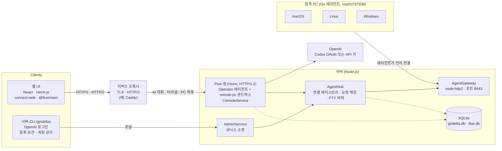

# gridelta: 원격 PC 관리 + AI 컨트롤 시스템 설계 문서

작성일: 2026-10-29

## 1. 개요

원격 PC에 설치한 에이전트를 서버가 관리하고, 사람은 웹 터미널로, AI는 자연어 지시로 그 PC에서 셸 명령을 실행하는 시스템이다. 통신은 ConnectRPC, AI 실행은 Flue로 구현한다. 오픈소스로 공개하며, 배포 환경(도메인·인증서·프록시)은 사용자마다 다르다는 것을 전제로 한다.

### 목표

- 서버–에이전트 구조: 원격 PC에 에이전트를 설치하면 서버에 등록되고 관리 대상이 된다.
- macOS, Linux, Windows 모두에서 셸 명령 실행.
- 웹 UI에서 PC를 선택해 터미널처럼 명령을 입력하고 결과를 본다.
- 서버 CLI에서 OpenAI OAuth 인증을 한다.
- AI에게 자연어로 지시하면 선택한 PC를 조작한다.

### 비목표 (1차 범위 밖)

- 원격 데스크톱(화면 공유, 마우스/키보드 제어)
- 다중 테넌트, 조직/권한 계층 (1차는 단일 관리자)
- 에이전트 자동 업데이트 (2차)
- 서버 수평 확장 (1차는 단일 서버 프로세스)
- PC별 실행 계정 지정 (2차, 5.4)

### 용어

| 용어 | 뜻 |
| --- | --- |
| 에이전트(Agent) | 원격 PC에 설치되는 Go 바이너리(`gridelta-agent`). Flue의 "agent"와 구분하기 위해 코드에서는 `Endpoint` 또는 `node`로 부를 것을 권장 |
| 서버(Server) | 에이전트 연결을 받고 UI·AI·CLI에 기능을 제공하는 Node.js 프로세스 |
| AI 에이전트 | Flue로 정의한 LLM 에이전트. 원격 PC를 샌드박스로 사용 |
| 세션 | 웹 터미널의 PTY 세션 1개 |

## 2. 전체 아키텍처

시스템은 Go 에이전트, Node.js 서버, 웹 UI, 서버 CLI 네 부분이다. 사람의 터미널 입력과 AI의 명령 모두 서버의 AgentHub를 거쳐 에이전트의 bidi 스트림으로 내려간다.



에이전트가 서버로 먼저 연결하므로 원격 PC에는 인바운드 포트가 필요 없다. 웹 UI는 터미널·PC 목록에 Connect API(`ConsoleService`)를, AI 대화에 Flue HTTP 라우트를 쓰며, 둘 다 같은 Flue 앱(메인 포트)에서 제공한다. 메인 포트 앞의 리버스 프록시가 필요한 이유는 6.1에 있다.

| 구성 | 언어/런타임 | 주요 라이브러리 |
| --- | --- | --- |
| 에이전트 | Go 1.27 | connect-go v2, aymanbagabas/go-pty (unix: creack/pty, windows: ConPTY), kardianos/service, golang.org/x/sys/windows, go.yaml.in/yaml/v3, log/slog |
| 서버 | Node.js 26 LTS / TypeScript 7 | @flue/runtime, Hono, Vite 8, @connectrpc/connect-node 2, node:sqlite + drizzle-orm 1.0 rc, @earendil-works/pi-ai, @node-rs/argon2, pino, valibot |
| 웹 UI | TypeScript / React 19 | @connectrpc/connect-web 2, @connectrpc/connect-query + TanStack Query, TanStack Router, @xterm/xterm 6, @flue/react, Tailwind 4 + shadcn/ui, zustand |
| CLI | TypeScript / Node.js 26 | commander 15, @clack/prompts, @connectrpc/connect-node, tsdown |
| 프로토콜 | Protobuf | buf CLI (buf.gen.yaml v2), protoc-gen-go, protoc-gen-connect-go (v2), protoc-gen-es 2 |
| 개발 도구 | — | pnpm 12 (catalogs), Biome, Vitest 5, goreleaser |
| 배포 앞단 | — | 리버스 프록시 (예시 설정은 Caddy로 제공) |

- 버전은 2026-10-29에 확인한 기준이다. 정확한 버전은 pnpm catalog와 `go.mod`로 고정한다.
- Flue(2026-02 시작, 메이저 버전이 빠르게 바뀜)와 drizzle-orm 1.0 rc는 정확한 버전으로 고정하고, 올릴 때는 변경 내역을 확인한다.

## 3. 저장소 구조

모노레포 하나에 proto, Go 에이전트, TS 서버·웹·CLI를 둔다. proto가 단일 진실 원천이며 Go/TS 코드는 Buf로 생성한다.

```
gridelta/
├─ proto/                     # .proto 원본 (buf 모듈)
│  └─ gridelta/v1/
│     ├─ gateway.proto        # 에이전트 ↔ 서버
│     ├─ console.proto        # 웹 ↔ 서버
│     ├─ admin.proto          # CLI ↔ 서버 (로컬 전용)
│     └─ common.proto
├─ buf.yaml / buf.gen.yaml    # Go: protoc-gen-go + protoc-gen-connect-go, TS: protoc-gen-es
├─ agent/                     # Go 모듈 (go 1.27)
│  ├─ cmd/gridelta-agent/main.go
│  ├─ internal/conn/          # 연결·재연결·디스패치
│  ├─ internal/exec/          # 단발 명령 실행 (unix: 프로세스 그룹, windows: Job Object)
│  ├─ internal/fs/            # 파일 작업
│  ├─ internal/pty/           # 자체 Pty 인터페이스 + go-pty 구현
│  ├─ internal/service/       # OS 서비스 등록 (kardianos/service)
│  └─ gen/                    # 생성 코드
├─ packages/
│  └─ proto/                  # TS 생성 코드 (@gridelta/proto), server·web·cli 공용
├─ server/                    # Node.js + TS
│  ├─ src/app.ts              # Flue 앱 라우터 (Hono), provider 등록, 게이트웨이 기동
│  ├─ src/db.ts               # Flue 대화 저장소 어댑터 (Flue 규약 파일)
│  ├─ src/gateway/            # AgentGateway node:http2 서버
│  ├─ src/rpc/                # ConsoleService · AdminService 핸들러
│  ├─ src/hub/                # AgentHub: 연결된 에이전트 레지스트리
│  ├─ src/agents/             # Flue AI 에이전트 정의
│  ├─ src/sandboxes/remote-pc.ts  # Flue 샌드박스 어댑터
│  ├─ src/auth/               # 웹 세션, OpenAI OAuth 토큰 저장/갱신
│  └─ src/store/              # 앱 DB (drizzle 스키마·마이그레이션). DB 접근은 이 안에서만
├─ cli/                       # 서버 관리 CLI (TS)
├─ web/                       # React + xterm.js + connect-web
├─ deploy/                    # 리버스 프록시 예시 설정 (Caddyfile 등)
└─ docs/
```

- 패키지 매니저: pnpm workspace (packages/proto, server, cli, web). 공통 의존성 버전은 catalog로 맞춘다.
- 태스크 실행: pnpm 스크립트(`pnpm -r`, `--filter`)와 Go·buf용 Makefile. 별도 모노레포 도구(turborepo 등)는 필요해질 때 도입한다.
- 코드 생성: `buf generate` 한 번으로 Go(`agent/gen`)와 TS(`packages/proto`)를 생성한다. 플러그인은 로컬 버전 고정(`@bufbuild/protoc-gen-es` devDependency, Go 플러그인은 `go tool`)으로 쓴다. 생성 코드는 커밋한다(에이전트 빌드에 buf 불필요).
- 에이전트 빌드: goreleaser로 크로스 컴파일, 1차 타깃은 darwin/arm64, darwin/amd64, linux/amd64, linux/arm64, windows/amd64.

## 4. ConnectRPC 프로토콜 설계

에이전트는 서버로 bidi 스트림 하나를 열고, 서버는 그 스트림으로 요청을 내려보낸다. 요청과 응답은 `request_id`로 짝을 맞춘다. 브라우저용 API는 unary와 서버 스트리밍만 쓴다.

### 4.1 서비스 구분

| 서비스 | 호출자 | 전송 | 스트리밍 |
| --- | --- | --- | --- |
| `AgentGateway` | 에이전트(Go) | HTTP/2 + TLS (8443) | bidi 스트림 1개 |
| `ConsoleService` | 웹 UI | 리버스 프록시 경유 HTTPS, 브라우저 구간 HTTP/2 | unary + 서버 스트림 |
| `AdminService` | CLI | 로컬 전용(유닉스 소켓) | unary |

- connect-web은 브라우저 제약 때문에 클라이언트/bidi 스트리밍을 지원하지 않는다(2026-10 기준 변화 없음). 그래서 터미널 입력은 unary, 출력은 서버 스트림으로 나눈다.
- 브라우저 구간은 HTTP/2가 필수다. HTTP/1.1이면 도메인당 연결이 6개 안팎으로 제한되는데, `WatchEndpoints`, `WatchApprovals`, 터미널 탭마다의 `AttachTerminal`이 연결을 계속 점유해 입력 요청이 막힌다.

### 4.2 gateway.proto (초안)

경로 필드는 모두 POSIX 형식이다(5.3). Windows 변환은 에이전트가 한다.

```proto
syntax = "proto3";
package gridelta.v1;

// Connect 는 Authorization: Bearer <credential> 헤더로 인증한다. Enroll 만 등록 토큰으로 인증.
service AgentGateway {
  // 에이전트가 연결을 열고 유지한다. 첫 메시지는 반드시 Hello.
  rpc Connect(stream AgentMessage) returns (stream ServerMessage);
  // 최초 등록: 등록 토큰 → 에이전트 자격 증명 발급
  rpc Enroll(EnrollRequest) returns (EnrollResponse);
}

message EnrollRequest {
  string enroll_token = 1;
  string hostname = 2;
  string os = 3;
  string arch = 4;
}
message EnrollResponse {
  string agent_id = 1;        // UUIDv7
  string credential = 2;      // 이후 Connect 인증에 사용. 서버에는 해시만 저장
}

message AgentMessage {
  oneof msg {
    Hello hello = 1;
    Heartbeat heartbeat = 2;    // Ping 에 대한 응답
    Response response = 3;      // ServerMessage.request 에 대한 응답
    PtyOutput pty_output = 4;   // PTY 출력(비동기)
    PtyExit pty_exit = 5;
  }
}

message ServerMessage {
  oneof msg {
    Welcome welcome = 1;
    Request request = 2;
    PtyInput pty_input = 3;     // 응답 불필요한 단방향 데이터
    PtyResize pty_resize = 4;
    Ping ping = 5;
  }
}

message Hello {
  string agent_id = 1;
  string os = 2;              // darwin | linux | windows
  string arch = 3;
  string hostname = 4;
  string agent_version = 5;
  string home_dir = 6;
  string default_shell = 7;   // /bin/zsh, /bin/bash, powershell.exe ...
  string os_user = 8;
}

message Welcome {
  string server_version = 1;
  string min_agent_version = 2;   // 정보용. 비호환이면 Welcome 대신 failed_precondition 으로 스트림을 닫음 (4.5)
  uint32 ping_interval_ms = 3;    // 기본 15000
}

message Ping      { uint64 nonce = 1; }
message Heartbeat { uint64 nonce = 1; }   // 받은 Ping.nonce 를 그대로 돌려줌

message Request {
  string request_id = 1;      // UUID, 서버가 발급
  oneof op {
    ExecRequest exec = 10;
    CancelRequest cancel = 11;  // 진행 중인 exec 취소(target_request_id)
    FsReadRequest fs_read = 20;
    FsWriteRequest fs_write = 21;
    FsStatRequest fs_stat = 22;
    FsReaddirRequest fs_readdir = 23;
    FsMkdirRequest fs_mkdir = 24;
    FsRmRequest fs_rm = 25;
    PtyOpenRequest pty_open = 30;
    PtyCloseRequest pty_close = 31;
  }
}

message Response {
  string request_id = 1;
  Error error = 2;            // 전송/실행 실패. 명령의 non-zero exit 는 에러가 아님
  oneof result {
    ExecResult exec = 10;
    FsReadResult fs_read = 20;
    FsStatResult fs_stat = 22;
    FsReaddirResult fs_readdir = 23;
    Empty ok = 29;
    PtyOpenResult pty_open = 30;
  }
}

message ExecRequest {
  string command = 1;
  string cwd = 2;
  map<string, string> env = 3;
  uint32 timeout_ms = 4;
  string shell = 5;           // 비우면 에이전트 기본값
}
message ExecResult {
  bytes stdout = 1;
  bytes stderr = 2;
  int32 exit_code = 3;        // 타임아웃 = 124
  bool truncated = 4;         // stdout+stderr 가 exec_output_limit 를 넘어 잘림 (4.5)
}

message CancelRequest { string target_request_id = 1; }

message FsReadRequest    { string path = 1; }
message FsReadResult     { bytes data = 1; }                    // 3 MiB 초과 파일은 too_large (청크 전송은 2차)
message FsWriteRequest   { string path = 1; bytes data = 2; }   // data 3 MiB 이하
message FsStatRequest    { string path = 1; }
message FsStatResult {                                          // 모르는 값은 비워 둠 (8.2)
  bool is_dir = 1;
  bool is_symlink = 2;
  optional uint64 size = 3;
  optional int64 mtime_ms = 4;
  optional uint32 mode = 5;
}
message FsReaddirRequest { string path = 1; }
message FsReaddirResult  { repeated string names = 1; }
message FsMkdirRequest   { string path = 1; bool recursive = 2; }
message FsRmRequest      { string path = 1; bool recursive = 2; bool force = 3; }

message PtyOpenRequest  { string session_id = 1; uint32 cols = 2; uint32 rows = 3; string shell = 4; string cwd = 5; }
message PtyOpenResult   { int32 pid = 1; }
message PtyCloseRequest { string session_id = 1; }
message PtyInput  { string session_id = 1; bytes data = 2; }
message PtyOutput { string session_id = 1; bytes data = 2; uint64 seq = 3; }  // seq 는 세션별 0부터 1씩 증가
message PtyResize { string session_id = 1; uint32 cols = 2; uint32 rows = 3; }
message PtyExit   { string session_id = 1; int32 exit_code = 2; }

message Empty {}

// code: not_found, permission_denied, invalid_argument, unsupported, too_large, canceled, internal
message Error { string code = 1; string message = 2; }
```

### 4.3 console.proto (초안)

```proto
service ConsoleService {
  rpc ListEndpoints(ListEndpointsRequest) returns (ListEndpointsResponse);
  rpc WatchEndpoints(WatchEndpointsRequest) returns (stream EndpointEvent); // 온라인/오프라인 변화

  // 웹 터미널
  rpc OpenTerminal(OpenTerminalRequest) returns (OpenTerminalResponse);     // session_id 발급
  rpc AttachTerminal(AttachTerminalRequest) returns (stream TerminalOutput); // 출력 스트림, from_seq 로 재접속
  rpc SendInput(SendInputRequest) returns (SendInputResponse);
  rpc ResizeTerminal(ResizeTerminalRequest) returns (ResizeTerminalResponse);
  rpc CloseTerminal(CloseTerminalRequest) returns (CloseTerminalResponse);

  // AI 승인 요청
  rpc WatchApprovals(WatchApprovalsRequest) returns (stream ApprovalRequest);
  rpc DecideApproval(DecideApprovalRequest) returns (DecideApprovalResponse);

  // AI 설정 (provider·모델 선택, M6)
  rpc GetAiSettings(GetAiSettingsRequest) returns (AiSettings);
  rpc UpdateAiSettings(UpdateAiSettingsRequest) returns (AiSettings);
}

message AttachTerminalRequest { string session_id = 1; uint64 from_seq = 2; }  // 받은 마지막 seq + 1, 처음은 0
message TerminalOutput {
  bytes data = 1;
  uint64 seq = 2;
  bool reset = 3;     // true 면 from_seq 이후 일부가 버퍼에서 밀려남 → 클라이언트는 화면을 초기화한 뒤 data 를 씀 (6.2)
  optional int32 exit_code = 4;  // 셸 종료 시 마지막 메시지에 담고 스트림 종료
}
message SendInputRequest { string session_id = 1; uint64 input_seq = 2; bytes data = 3; }  // input_seq 로 순서·중복 처리 (7.2)
```

### 4.4 admin.proto (초안)

CLI 전용이며 유닉스 소켓에서만 수신한다. 소켓 파일 권한(0600, 서버 실행 계정 소유)이 곧 인증이다.

```proto
service AdminService {
  rpc CreateEnrollToken(CreateEnrollTokenRequest) returns (CreateEnrollTokenResponse); // token, expires_at, ca_fingerprint
  rpc ListEndpoints(ListEndpointsRequest) returns (ListEndpointsResponse);
  rpc RevokeEndpoint(RevokeEndpointRequest) returns (RevokeEndpointResponse);
  rpc CreateUser(CreateUserRequest) returns (CreateUserResponse);
  rpc StoreOAuthToken(StoreOAuthTokenRequest) returns (StoreOAuthTokenResponse);       // provider, Pi 자격 증명(JSON)
  rpc DeleteOAuthToken(DeleteOAuthTokenRequest) returns (DeleteOAuthTokenResponse);
  rpc GetAuthStatus(GetAuthStatusRequest) returns (GetAuthStatusResponse);
}
```

AI 대화 자체는 Flue가 제공하는 HTTP 라우트(8.1)와 `@flue/react`의 `useFlueAgent` 훅을 그대로 쓴다. Connect로 다시 감싸지 않는다.

### 4.5 규칙

- **상관 id**: 서버가 `request_id`를 발급하고, 에이전트는 응답에 그대로 돌려준다. 서버는 `Map<request_id, {resolve, reject, timer}>`로 대기한다. 모든 `Request`는 정확히 하나의 `Response`를 받는다(`pty_close`, `fs_write` 등은 `ok`).
- **취소**: `CancelRequest`도 하나의 `Request`이므로 자신의 `Response`를 받는다. 대상이 실행 중이면 `ok`, 이미 끝났거나 없으면 `not_found`. 취소된 대상 exec는 프로세스를 정리한 뒤 `Error{code: "canceled"}`로 응답하며, 서버는 abort 시점에 이미 pending을 지웠으므로 이 응답을 버린다.
- **동시성**: 에이전트는 요청마다 goroutine으로 처리하고, 스트림 송신은 단일 writer goroutine(채널)으로 직렬화한다.
- **크기 상한**:
  - 메시지 하나는 4 MiB 이하. 양쪽 모두 수신 상한을 4 MiB로 설정한다(connect-go `WithReadMaxBytes`, connect-node `readMaxBytes`).
  - `exec` 출력은 stdout과 stderr를 합쳐 `exec_output_limit`(기본 1 MiB, 설정 최대 3 MiB)까지 담고 넘치면 `truncated`. 나머지 1 MiB는 메시지 오버헤드 여유분이다. 모델 컨텍스트에 넣을 출력으로는 1 MiB도 충분히 크다.
  - 파일 읽기·쓰기는 3 MiB 이하만 지원하고 넘으면 `too_large`. 큰 파일 전송은 2차 범위(청크 분할).
  - PTY 출력은 32 KiB 단위로 나눠 보내므로 상한과 무관하다.
- **버전**: 서버는 `Hello.agent_version`이 최소 버전보다 낮으면 `Welcome`을 보내지 않고 `failed_precondition` 에러로 스트림을 닫는다. 에이전트는 이 에러를 받으면 짧은 백오프 대신 1시간 간격으로만 재시도한다. 필드는 추가만 하고 번호 재사용 금지.
- **하트비트**: 서버가 `Welcome.ping_interval_ms`(기본 15초) 간격으로 `Ping`을 보내고, 에이전트는 같은 `nonce`의 `Heartbeat`로 답한다. 서버는 45초 동안 에이전트에게서 아무 메시지도 받지 못하면 연결을 끊고 오프라인 처리한다. 에이전트도 45초 동안 아무것도 받지 못하면 스스로 끊고 재연결한다. HTTP/2 PING(5.1)은 죽은 TCP 연결만 잡으므로 애플리케이션 수준 하트비트도 유지한다.

## 5. 에이전트 (Go) 설계

에이전트는 root/SYSTEM 권한의 OS 서비스로 상주하며 서버에 아웃바운드 연결을 유지하고, 받은 요청을 실행해 결과를 돌려주는 단일 바이너리다.

### 5.1 연결 수명주기

1. 시작 시 설정 파일에서 서버 URL과 자격 증명을 읽는다. 없으면 `gridelta-agent enroll --server <url> --token <등록토큰> [--ca-fingerprint <sha256>]`으로 먼저 등록한다.
   - `gridelta enroll-token create`가 이 명령줄을 통째로 출력한다. 서버가 자체 서명 인증서를 쓰면 `--ca-fingerprint`가 포함되고, 에이전트는 첫 접속부터 그 지문으로 서버를 검증해 설정 파일에 저장한다. 공인 인증서면 생략하고 OS 신뢰 저장소로 검증한다.
   - 등록이 끝나면 `Enroll`이 준 `agent_id`와 `credential`을 설정 파일에 쓴다. 이후 `Connect`는 `Authorization: Bearer <credential>` 헤더로 인증한다.
2. connect-go v2 클라이언트로 `AgentGateway.Connect`를 연다. 첫 메시지로 `Hello` 전송.
   - 전송: 표준 라이브러리 `http.Transport`에 `ForceAttemptHTTP2: true`(사용자 TLS 설정을 쓰면 이게 없을 때 HTTP/1.1로 떨어져 bidi가 실패함), `HTTP2: &http.HTTP2Config{SendPingTimeout, PingTimeout, WriteByteTimeout}`로 연결 상태 확인.
   - `http.Client.Timeout`은 0으로 둔다(스트림 전체에 걸리기 때문). 취소는 context로 한다. 리다이렉트는 거부한다.
3. 수신 루프: `Request`마다 goroutine을 띄워 처리하고, 결과는 송신 채널로 보낸다.
4. 끊기면 지수 백오프(1s → 최대 60s, full jitter, 일정 시간 안정적으로 연결되면 초기화)로 재연결한다. 백오프는 라이브러리 없이 직접 구현한다. 실행 중이던 exec는 계속 돌되 결과는 버린다. PTY 세션은 30초 유예 후 정리.

### 5.2 기능별 구현

| 기능 | 구현 | 비고 |
| --- | --- | --- |
| exec (unix) | `exec.CommandContext(shell, "-lc", cmd)`, `SysProcAttr{Setpgid: true}` | 취소·타임아웃 시 `cmd.Cancel`로 프로세스 그룹에 SIGTERM → 2초 후 SIGKILL. `cmd.WaitDelay`로 손자 프로세스가 파이프를 쥐고 있어도 `Wait`가 멈추지 않게 함 |
| exec (windows) | `powershell.exe -NoProfile -NonInteractive -Command <cmd>` 기본, 설정으로 `cmd.exe /C` 선택 | `golang.org/x/sys/windows`로 Job Object 직접 구현(`KILL_ON_JOB_CLOSE`). `Start()` 직후 Job에 넣기 전 짧은 틈은 M4에서 처리 방법 확정 |
| 파일 | `os` 패키지 직접 사용 | 경로는 에이전트에서 OS 경로로 변환 (5.3) |
| PTY | `github.com/aymanbagabas/go-pty` (unix: creack/pty, windows: ConPTY를 한 API로) | 자체 `Pty` 인터페이스로 감싸 교체 가능하게 함(대안: `charmbracelet/x/xpty`). 출력 32 KiB 단위로 묶어 전송. Windows는 10 1809 이상, 자식 프로세스 정리는 Job Object와 함께 |
| 서비스 등록 | `github.com/kardianos/service` | macOS LaunchDaemon, Linux systemd 시스템 유닛, Windows LocalSystem 서비스(실패 시 재시작) |
| 설정 파일 | `go.yaml.in/yaml/v3` | `gopkg.in/yaml.v3`는 아카이브됨. API 동일 |
| 로깅 | `log/slog` | 로그 회전은 OS(journald, newsyslog)에 맡김 |

### 5.3 경로 규칙

Flue 샌드박스는 POSIX 경로(`/` 구분)를 전제로 한다. 프로토콜의 모든 경로는 POSIX 형식이고, Windows 에이전트는 다음 규칙으로 변환한다.

| POSIX (프로토콜) | Windows | 비고 |
| --- | --- | --- |
| `/c/Users/me/file.txt` | `C:\Users\me\file.txt` | 드라이브 문자는 소문자 한 글자 세그먼트. 입력은 대문자 `/C/...`도 허용 |
| `/c` | `C:\` | 드라이브 루트 |
| `/unc/server/share/dir` | `\\server\share\dir` | UNC 경로. `unc`는 세 글자라 드라이브 세그먼트와 겹치지 않음 |
| `/` | (가상 루트) | `readdir("/")`는 존재하는 드라이브(`c`, `d`, …)와 `unc`를 돌려줌. `stat("/")`는 디렉터리. 쓰기·삭제는 `permission_denied` |

- 에이전트→서버(`Hello.home_dir`, 목록 결과)는 반대로 변환한다. `\\?\C:\...`처럼 긴 경로 접두사가 붙은 경로는 접두사를 떼고 변환하며, `\\?\UNC\server\share`는 `/unc/server/share`로 바꾼다.
- 드라이브 문자 없는 상대 경로(`C:foo`)와 장치 경로(`\\.\PIPE\...`)는 지원하지 않고 `invalid_argument`로 거부한다.
- `..`는 변환 전에 POSIX 기준으로 정규화한다. `/c/..`는 `/`가 된다.
- 변환 함수는 위 표의 모든 행을 양방향 테스트한다.

### 5.4 실행 권한

- 에이전트는 root(macOS·Linux) / LocalSystem(Windows)으로 실행한다. 설치에는 관리자 권한이 필요하다.
- 1차에서는 exec·PTY·파일 작업 모두 에이전트 권한(root/SYSTEM) 그대로 실행한다. 웹 터미널과 AI가 root 셸을 얻으므로 승인 정책(8.5)과 감사 로그(10장)를 전제로 한다.
- 2차: PC별 "실행 계정" 설정을 두고, 지정한 OS 사용자로 권한을 낮춰 셸을 연다(unix: `SysProcAttr.Credential`, windows: 사용자 토큰).
- Windows는 서비스가 session 0에서 돈다. 이 상태에서 ConPTY가 정상 동작하는지 M4에서 가장 먼저 확인한다.
- 환경변수: exec는 에이전트 프로세스의 환경을 상속하되, 에이전트 자격 증명 관련 변수는 제거한다. root로 실행되므로 `HOME`은 root의 홈(`/var/root`, `/root`, `systemprofile`)이 되며 `Hello.home_dir`도 그 값을 보낸다.

### 5.5 설정 파일

```yaml
# unix: /etc/gridelta/agent.yaml (root 소유, 0600)
# windows: %ProgramData%\gridelta\agent.yaml (SYSTEM·Administrators만 접근)
server_url: https://grid.example.com:8443
agent_id: 019a3c5e-...          # UUIDv7, Enroll 때 서버가 발급
credential: <서버가 발급한 비밀 토큰>
ca_fingerprint: ""              # 자체 서명 인증서일 때 등록 시 고정한 CA 지문 (10장)
shell: ""                       # 비우면 OS 기본
exec_output_limit: 1048576      # stdout+stderr 합계, 최대 3145728 (4.5)
```

## 6. 서버 설계

서버는 Node.js 단일 프로세스로, Flue 앱(메인 포트)·AgentGateway(8443)·AdminService(유닉스 소켓)를 함께 띄운다. 세 서버가 같은 AgentHub 인스턴스를 공유하며, 모든 원격 작업은 AgentHub 하나를 거친다.

### 6.1 프로세스 구성

Flue가 빌드한 서버(`dist/server.mjs`)는 `@hono/node-server`로 `PORT`(기본 3000)에 **HTTP/1.1, 평문**으로 뜨며 서버를 교체할 공식 방법이 없다. 그래서 다음과 같이 구성한다.

| 포트 | 서버 | 내용 |
| --- | --- | --- |
| 메인 (프록시 뒤, 기본 3000) | Flue 빌드 서버 | Flue 에이전트 라우트, `ConsoleService`, 웹 정적 파일, 웹 로그인 |
| 8443 | `node:http2` `createSecureServer` + `connectNodeAdapter` | `AgentGateway` (bidi에 HTTP/2 필수) |
| 유닉스 소켓 | `node:http` + `connectNodeAdapter` | `AdminService` (CLI 전용) |

- **메인 포트 앞에는 리버스 프록시가 필요하다.** 브라우저 구간에 TLS와 HTTP/2를 제공하기 위해서다(4.1). 프록시→Flue 구간은 HTTP/1.1이어도 된다. 프록시는 스트리밍 응답을 버퍼링하지 않고 긴 연결 타임아웃을 허용해야 한다. 저장소에 Caddy 예시 설정을 제공한다.
- **ConsoleService**는 Flue의 Hono 앱 안에 마운트한다. `connectNodeAdapter` 핸들러를 `c.env.incoming`/`c.env.outgoing`으로 호출하고 `RESPONSE_ALREADY_SENT`를 반환하는 방식, 또는 `@connectrpc/connect/protocol`의 `createFetchHandler`를 쓴다. 공식 Hono 어댑터는 없으므로 M1에서 서버 스트림까지 검증한다.
- **AgentGateway**는 `app.ts`의 최상위 부수 효과로 띄운다. Vite 개발 모드 재로드 시 중복 listen을 막는 가드(`globalThis` 플래그)를 둔다. 인증서는 서버 설정으로 경로를 지정하거나, 프록시가 TLS를 종료하고 h2c로 전달하게 할 수 있다(배포 환경에 따라 선택, 10장).
- 서버 진입점을 직접 작성해 Flue 앱을 감싸는 방식(`http2.createSecureServer({ allowHTTP1: true })` + Flue fetch 핸들러)도 가능하지만 Flue가 지원하지 않는 내부 API에 의존하므로 쓰지 않는다.

### 6.2 AgentHub

```ts
interface EndpointInfo { id: string; os: 'darwin'|'linux'|'windows'; hostname: string; homeDir: string; online: boolean; lastSeen: Date; }

class AgentHub {
  list(): EndpointInfo[];
  get(id: string): EndpointConn | undefined;
  // 요청-응답
  request<T>(id: string, op: RequestOp, opts?: { timeoutMs?: number; signal?: AbortSignal }): Promise<T>;
  // PTY
  openPty(id: string, opts): Promise<PtySession>;   // 출력은 링버퍼(256 KiB) + 구독자
  events: EventEmitter;                             // online/offline/pty-output
}
```

- 연결별로 `pending: Map<requestId, Deferred>`를 유지한다.
- **오프라인 에러는 하나로 통일한다.** 호출 시점에 PC가 연결되어 있지 않을 때도, 호출 도중 연결이 끊길 때도 `EndpointOfflineError`로 reject한다. 샌드박스 어댑터는 이를 `SandboxDiedError`로 바꿔 Flue에 넘기고(8.2), `ConsoleService`는 Connect `unavailable` 코드로 바꾼다.
- `signal` abort 시 에이전트에 `CancelRequest`를 보내고 pending을 즉시 reject한다(Flue의 orphan 처리와 맞물림, 8장).
- 에이전트가 `Hello`를 보내면 `os`, `home_dir`, `default_shell`, `hostname`을 `endpoints` 테이블에 갱신한다. PC가 오프라인이어도 마지막 정보를 쓸 수 있게 하기 위함이다(8.2).

**PTY 세션과 링버퍼**

- 세션별 링버퍼(256 KiB)에 `PtyOutput`을 `seq`와 함께 쌓는다. 버퍼가 차면 오래된 청크부터 버린다.
- `AttachTerminal(from_seq)` 처리:
  - `from_seq`가 버퍼에 남아 있으면 그 지점부터 보내고, 이후 실시간 출력을 이어 보낸다.
  - `from_seq`가 이미 밀려났으면 첫 메시지에 `reset: true`를 붙여 버퍼에 남은 가장 오래된 청크부터 보낸다. 클라이언트는 `term.reset()` 후 받은 데이터를 쓴다. 중간부터 재생하면 화면이 깨질 수 있으므로, 서버는 이어서 PTY 크기를 한 줄 줄였다가 되돌려 SIGWINCH를 일으킨다. 전체 화면 프로그램(vim, top)은 이 신호에 화면을 다시 그린다.
  - `from_seq`가 미래 값(서버 재시작 등으로 seq가 초기화됨)이면 `reset`과 같은 방식으로 처리한다.
- 세션은 `CloseTerminal`, 셸 종료(`PtyExit`), 구독자 없이 30분 경과 중 하나로 닫는다. 셸이 종료되면 `TerminalOutput.exit_code`를 담아 스트림을 끝낸다.
- 서버가 재시작되면 링버퍼와 세션 정보는 사라진다. 에이전트 쪽 PTY는 30초 유예 후 정리되므로(5.1), 1차에서는 서버 재시작 시 터미널 세션을 다시 열어야 한다.

### 6.3 저장소 (SQLite)

DB는 SQLite 하나로 가되, 앱 데이터와 Flue 대화 기록은 **파일을 나눈다**. 둘 다 Node 내장 `node:sqlite`를 쓰므로 네이티브 의존성이 없다.

| 파일 | 내용 | 접근 |
| --- | --- | --- |
| `data/gridelta.db` | 아래 앱 테이블 | drizzle-orm 1.0 rc (`drizzle-orm/node-sqlite`), 마이그레이션은 drizzle-kit. `src/store/` 안에서만 접근 |
| `data/flue.db` | Flue 대화 기록 | `src/db.ts`에서 `sqlite('./data/flue.db')` (`@flue/runtime/node`). Flue가 테이블과 포맷 버전을 직접 관리 |

- `src/db.ts`가 없으면 Flue는 메모리 DB를 써서 재시작 시 대화가 사라진다. 반드시 둔다.
- drizzle 1.0은 rc이므로 정확한 버전으로 고정한다. 문제가 생기면 테이블이 적어 SQL 직접 작성으로 되돌리기 쉽다. drizzle-kit 마이그레이션이 `node:sqlite`에서 동작하는지는 M2에서 먼저 확인한다.

| 테이블 | 주요 컬럼 |
| --- | --- |
| endpoints | id, hostname, os, arch, home_dir, default_shell, agent_version, credential_hash, enrolled_at, last_seen, revoked_at, labels, approval_policy |
| enroll_tokens | token_hash, expires_at, used_at |
| users | id, username, password_hash (1차는 관리자 1명) |
| sessions | id, user_id, created_at, expires_at (웹 로그인 세션) |
| audit_log | id, at, actor(user/ai), endpoint_id, kind(exec/pty/fs), command, exit_code, approval_id |
| approvals | id, endpoint_id, command, requested_by(ai session), status, decided_by, decided_at |
| oauth_tokens | provider(`openai-codex`), credential(암호화), key_version, expires_at, account |
| settings | key, value (AI provider, 기본 모델 등) |

- 비밀번호: argon2id (`@node-rs/argon2`).
- 암호화: `node:crypto` AES-256-GCM. 레코드마다 12바이트 랜덤 IV, 인증 태그 저장, AAD에 provider/행 id. 키는 마스터 키에서 HKDF로 파생하고 `key_version`으로 교체에 대비한다.

### 6.4 웹 인증

- 1차: 관리자 계정 + 서버 측 세션. 쿠키에는 세션 id만 담는다(`hono/cookie`, HttpOnly, Secure, SameSite=Strict). 계정은 CLI로 생성.
- 검증 함수 `verifySession()` 하나를 Hono 미들웨어(Flue 에이전트 라우터 마운트보다 앞)와 Connect 인터셉터에서 함께 쓴다.
- Flue 라우트는 "대화 URL에 접근할 수 있으면 누구나 대화할 수 있다"는 전제이므로, 인증 미들웨어 없이 노출하지 않는다.

## 7. 웹 터미널 UI 설계

웹 UI는 왼쪽에 PC 목록, 오른쪽에 탭별 터미널과 AI 채팅 패널을 두는 React 단일 페이지 앱이다.

스택: React 19, Vite 8, TanStack Router(선택 PC·탭을 URL search param으로), TanStack Query + connect-query(unary 호출), zustand(UI 상태), Tailwind 4 + shadcn/ui(Radix 기반 대화상자·탭·분할 패널). 서버 스트림(`WatchEndpoints`, `AttachTerminal`, `WatchApprovals`)은 connect-query 대신 직접 구독한다.

### 7.1 화면 구성

- **PC 목록**: `WatchEndpoints` 스트림으로 온라인 상태 실시간 표시. OS 아이콘, 호스트명, 마지막 접속 시각.
- **터미널 탭**: PC 하나에 여러 PTY 세션을 탭으로 연다. `@xterm/xterm` 6 + addon-fit, addon-webgl(컨텍스트 손실 시 DOM 렌더러로 전환), addon-unicode11(한글·이모지 폭), addon-web-links. React 래퍼 없이 자체 `useXterm` 훅으로 생명주기를 관리한다.
- **AI 패널**: 선택한 PC에 대해 Flue AI 에이전트와 대화. `@flue/react`의 `useFlueAgent` 훅을 쓴다. 훅만 제공되므로 메시지와 도구 호출 카드(`dynamic-tool` 파트)는 shadcn으로 직접 만든다.
- **모델 선택**: AI 패널에서 모델을 고른다. 기본값은 `gpt-5.6-sol` (M6).
- **승인 대기열**: AI가 요청한 위험 명령이 뜨면 명령 전문과 대상 PC를 보여주고 승인/거부. Flue에는 승인 기능이 없으므로 `ConsoleService`의 자체 RPC로 구현한다.
- **감사 로그**: 사람·AI가 실행한 명령 이력 조회.

### 7.2 터미널 데이터 흐름

1. `OpenTerminal(endpoint_id, cols, rows)` → `session_id`
2. `AttachTerminal(session_id, from_seq=0)` 서버 스트림 구독 → xterm에 write
3. 키 입력: xterm `onData` → 16 ms 동안 모아서 `SendInput` (unary). 입력 묶음마다 `input_seq`(세션별 0부터 1씩 증가)를 붙인다. 서버는 이미 처리한 `input_seq`는 무시하고 성공으로 응답하므로 재시도해도 안전하다. 1차는 클라이언트 직렬 큐로 보낸다.
4. 창 크기 변경: `ResizeTerminal` (디바운스 100 ms)
5. 스트림이 끊기면 받은 마지막 `seq + 1`로 재구독한다. `reset: true`를 받으면 화면을 초기화하고 다시 그린다(6.2).
6. `exit_code`가 담긴 메시지를 받으면 탭에 종료 상태를 표시한다.

### 7.3 지연 대응

unary 입력 방식은 키 입력 묶음마다 HTTP 요청이 생긴다. 브라우저–서버 구간이 HTTP/2이면 연결 재사용으로 대부분 충분하다. 참고로 비슷한 웹 터미널(ttyd, Teleport, Coder 등)은 터미널 입출력에 WebSocket을 쓴다. M3에서 체감 지연을 측정해 50 ms를 넘으면 터미널 입출력만 WebSocket(같은 Hono 앱에 마운트, 바이너리 protobuf 프레임)으로 바꾼다. AgentHub의 PtySession 인터페이스는 전송 방식과 무관하게 설계한다.

## 8. AI 컨트롤 (Flue)

원격 PC를 Flue의 커스텀 샌드박스로 연결한다. 그러면 Flue 기본 도구(`read`, `write`, `edit`, `bash`, `grep`, `glob`)가 그대로 원격 PC에서 동작하므로, 셸 도구를 따로 만들 필요가 없다.

### 8.1 대화와 PC의 연결

- 에이전트 라우터는 `app.route('/agents/operator', createAgentRouter(Operator))`로 마운트한다(`@flue/runtime/routing`). 제공 라우트: `POST /:id`(메시지 전송, 202), `GET /:id`(스냅샷·롱폴·SSE), `HEAD /:id`, `POST /:id/abort`, `GET /:id/attachments/:aid`.
- Flue 에이전트 인스턴스 id(URL의 `:id`) = `<endpoint_id>:<대화 id>` 형식. 샌드박스 팩토리는 `createSandbox({ id })`로 이 id를 받으므로 앞부분으로 대상 PC를 찾는다. `createSandbox`는 같은 id로 여러 번 불릴 수 있으므로 상태를 두지 않는다.
- 한 대화는 한 PC에 묶인다. 여러 PC를 다루는 작업은 2차 범위(서브에이전트 또는 커스텀 도구로 PC 전환).

### 8.2 샌드박스 어댑터

```ts
// server/src/sandboxes/remote-pc.ts
import { sandboxFromDriver, SandboxDiedError, type SandboxDriver, type SandboxFactory } from '@flue/runtime';
import { hub, EndpointOfflineError, type RequestOp, type RequestOpts } from '../hub';
import { endpoints } from '../store/endpoints';

export function remotePc(): SandboxFactory {
  return {
    async createSandbox({ id }) {
      const endpointId = id.split(':')[0];
      // 마지막 Hello 기준 정보. PC가 오프라인이어도 있으므로 대화 기록은 열리고, 원격 호출만 실패한다
      const ep = await endpoints.get(endpointId);
      if (!ep || ep.revokedAt) throw new Error(`등록되지 않았거나 폐기된 PC입니다: ${endpointId}`);

      // AgentHub 의 오프라인 에러를 Flue 의 SandboxDiedError 로 바꾼다 (6.2)
      const call = <T>(op: RequestOp, opts?: RequestOpts) =>
        hub.request<T>(endpointId, op, opts).catch((e) => {
          throw e instanceof EndpointOfflineError ? new SandboxDiedError(e.message) : e;
        });

      const driver: SandboxDriver = {
        exec: (command, o) => execWithApproval(endpointId, command, o, call),
        readFile: (p) => call({ fsRead: { path: p } }).then(r => utf8(r.data)),
        readFileBuffer: (p) => call({ fsRead: { path: p } }).then(r => r.data),
        writeFile: (p, c) => call({ fsWrite: { path: p, data: toBytes(c) } }),
        stat: (p) => call({ fsStat: { path: p } }).then(toFileStat),
        readdir: (p) => call({ fsReaddir: { path: p } }).then(r => r.names),
        // 파일이 없거나 접근할 수 없으면 false. 연결이 끊긴 것은 "없음"과 다르므로 SandboxDiedError 를 그대로 던진다
        exists: (p) => call({ fsStat: { path: p } }).then(() => true, (e) => { if (e instanceof SandboxDiedError) throw e; return false; }),
        mkdir: (p, o) => call({ fsMkdir: { path: p, recursive: !!o?.recursive } }),
        rm: (p, o) => call({ fsRm: { path: p, recursive: !!o?.recursive, force: !!o?.force } }),
      };
      return sandboxFromDriver(driver, ep.homeDir);
    },
    // 8.4: tools 는 sandbox 를 받으므로 cwd 형태(/c/...)로 Windows 여부를 판별. 동기 함수여야 함
    tools: (sandbox) => isWindowsCwd(sandbox.cwd) ? windowsTools(sandbox) : defaultTools(sandbox),
  };
}
```

`defaultTools`는 `createReadTool`, `createWriteTool`, `createEditTool`, `createBashTool`, `createGrepTool`, `createGlobTool` 6개를 모은 배열이다.

어댑터 계약에서 지킬 것:

- `exec`는 명령이 끝나면 non-zero exit도 `ShellResult`로 resolve한다. reject는 전송 실패와 abort에만 쓴다.
- `timeoutMs`는 에이전트의 `ExecRequest.timeout_ms`로 그대로 전달하고, 에이전트가 시간 초과 시 `exitCode: 124`로 응답한다.
- `signal`은 AgentHub에 넘겨 `CancelRequest`로 실제 프로세스를 죽인다. 어댑터 안에서 별도의 abort race를 만들지 않는다(`sandboxFromDriver`가 이미 처리).
- PC가 오프라인이면(호출 시점이든 도중이든) `SandboxDiedError`로 reject한다. `createSandbox` 자체는 PC가 오프라인이어도 성공한다. 등록되지 않았거나 폐기된 PC일 때만 실패한다.
- `exists`는 파일 부재·권한 문제로는 throw하지 않고 `false`를 돌려준다. Flue 계약의 "절대 throw하지 않음"을 파일 상태에 대한 것으로 해석해, 연결 끊김만은 `SandboxDiedError`로 던진다. 이 해석이 Flue 동작과 맞는지 M5에서 확인한다.
- `FileStat`에서 모르는 값은 가짜로 채우지 않고 생략한다(`FsStatResult`의 optional 필드).
- `rm`은 `recursive`/`force`를 정확히 지키거나, 지원하지 못하면 `SandboxOperationUnsupportedError`를 던진다.
- 드라이버로 들어오는 경로는 POSIX 절대 경로다. Windows 변환은 에이전트에서 한다(5.3).

### 8.3 AI 에이전트 정의

```ts
// server/src/agents/operator.ts
'use agent';
import { useModel, useSandbox } from '@flue/runtime';
import { remotePc } from '../sandboxes/remote-pc';
import { aiSettings } from '../store/settings';

export function Operator() {
  const { provider, model } = aiSettings();    // 기본값: openai-codex / gpt-5.6-sol
  useModel(`${provider}/${model}`, { thinkingLevel: 'medium' });
  useSandbox(remotePc());
  return [
    '당신은 원격 PC를 관리하는 운영자입니다.',
    '명령을 실행하기 전에 무엇을 할지 짧게 말하고, 파괴적인 작업은 꼭 필요할 때만 하십시오.',
    '대상 PC 정보: OS, 셸, 홈 디렉터리는 작업 공간 정보를 따르십시오.',
  ].join('\n');
}
```

- 시스템 프롬프트에 대상 PC의 OS·셸을 넣는다. 정보는 AgentHub의 `EndpointInfo`에서 가져온다.
- provider와 모델은 `settings` 테이블에서 읽는다. 기본은 `openai-codex`(ChatGPT 구독 OAuth) + `gpt-5.6-sol`이며, provider별로 쓸 수 있는 모델이 다르다(9.3).

### 8.4 Windows 대응

모델은 `bash` 도구 이름 때문에 bash 문법을 쓰기 쉽다. Windows PC에서는 샌드박스의 `tools` 함수로 기본 도구 세트를 교체한다.

- `createReadTool`, `createWriteTool`, `createEditTool`은 그대로 사용(파일 동사만 필요).
- `bash`, `grep`, `glob` 대신 `powershell` 도구 하나를 직접 정의해 `sandbox.exec`를 호출.
- 시스템 프롬프트에 "PowerShell 문법 사용"을 명시.

### 8.5 승인 (사람 확인)

`execWithApproval`이 모든 AI 명령의 관문이다. 에이전트가 root/SYSTEM으로 실행되므로(5.4) 이 관문이 AI 오작동에 대한 주된 방어선이다.

1. 정책 검사: 허용 목록(읽기 전용 명령)이면 바로 실행.
2. 위험 패턴(`rm -rf`, `del /s`, `format`, `shutdown`, `reboot`, `mkfs`, `dd`, 레지스트리 수정, 패키지 제거 등)이거나 정책이 "항상 승인"이면 `approvals`에 기록하고 UI에 알린다.
3. 승인될 때까지 대기(최대 10분). 거부되면 `exitCode: 126`, stderr에 "사용자가 실행을 거부함"을 담아 resolve한다. 모델이 이유를 알고 다른 방법을 찾게 하기 위함.
4. 실행 결과는 모두 `audit_log`에 `actor=ai`로 기록.

승인 정책은 PC별로 `항상 승인` / `위험 명령만` / `자동 실행` 중 선택. 기본값은 `위험 명령만`.

## 9. 서버 CLI와 OpenAI 인증

CLI(`gridelta`)는 서버 호스트에서 실행하는 관리 도구로, OpenAI 로그인·에이전트 등록 토큰 발급·관리자 계정 관리를 맡는다. OpenAI 인증은 Pi(`@earendil-works/pi-ai`)에 이미 구현된 `openai-codex` provider의 OAuth를 그대로 쓴다. 받은 자격 증명은 서버 DB에 암호화해 저장하고, Flue provider가 요청마다 읽어 쓴다.

### 9.1 명령

| 명령 | 동작 |
| --- | --- |
| `gridelta login openai` | OAuth 로그인 (9.2). 기본 PKCE, `--device`로 디바이스 코드 |
| `gridelta logout openai` | 저장된 토큰 삭제 |
| `gridelta auth status` | 로그인 계정, 만료 시각, 현재 provider |
| `gridelta enroll-token create --ttl 1h` | 에이전트 등록용 1회성 토큰 발급. 에이전트에서 실행할 `gridelta-agent enroll ...` 명령줄(자체 서명이면 CA 지문 포함)을 출력 |
| `gridelta endpoints list` / `revoke <id>` | 에이전트 목록, 자격 증명 폐기 |
| `gridelta user create <name>` | 웹 관리자 계정 생성 |

CLI는 commander 15 + @clack/prompts로 만들고, `AdminService`(유닉스 소켓, `createConnectTransport({ httpVersion: '1.1', nodeOptions: { socketPath } })`)로 서버와 통신한다.

### 9.2 로그인 흐름

Pi `openai-codex` provider의 `auth.oauth.login()`을 CLI에서 호출한다. 엔드포인트·client id·scope는 Pi 구현을 따른다.

1. **기본: 브라우저 PKCE.** 로컬 콜백(`localhost:1455/auth/callback`)으로 받는다. 이 포트는 Codex CLI와 같으므로 동시에 쓰면 충돌한다.
2. **브라우저가 없는 서버:** CLI가 로그인 URL을 출력하고, 사용자가 다른 기기에서 로그인한 뒤 리디렉션된 URL을 CLI에 붙여 넣는다(Pi 지원 방식).
3. **`--device`: 디바이스 코드.** OpenAI의 비표준 디바이스 흐름(RFC 8628 아님)이며 베타라서, ChatGPT 보안 설정 또는 워크스페이스 관리자가 켜야 쓸 수 있다.
4. 발급된 자격 증명을 `AdminService.StoreOAuthToken`으로 서버에 전달 → `oauth_tokens`에 암호화 저장(키는 서버 설정의 마스터 키에서 파생).

### 9.3 Flue와 연결

provider는 설정으로 고른다.

| provider | 인증 | 모델 | 용도 |
| --- | --- | --- | --- |
| `openai-codex` (기본) | ChatGPT 구독 OAuth (9.2) | `gpt-5.6-*` (기본 `gpt-5.6-sol`) | 일반 사용 |
| `openai` | `OPENAI_API_KEY` | OpenAI API 모델 | 개발(M5), 약관상 API 키가 필요한 사용자 |

`openai-codex`를 쓸 때는 `app.ts`에서 같은 id로 provider를 다시 등록해(같은 id면 내장 provider를 대체) 자격 증명을 DB에서 읽게 한다. `auth.apiKey.resolve()`는 요청마다 호출되므로 여기서 만료를 확인하고 refresh한다.

```ts
// server/src/app.ts (발췌, 정확한 시그니처는 M6에서 확인)
import { setProvider } from '@flue/runtime';
import { openaiCodexProvider } from '@earendil-works/pi-ai/providers/openai-codex';
import { getValidCodexAuth } from './auth/openai';

const codex = openaiCodexProvider();
setProvider({
  ...codex,
  auth: { apiKey: { name: 'gridelta OAuth store', resolve: () => getValidCodexAuth(codex.auth.oauth) } },
});
```

- `getValidCodexAuth()`: 만료 5분 전이면 `oauth.refresh()` 후 DB 갱신, `oauth.toAuth()`로 변환해 반환. 동시 refresh는 단일 Promise로 묶는다(Pi의 `CredentialStore`는 Flue가 노출하지 않으므로 직접 구현).
- 직접 의존하는 `@earendil-works/pi-ai`는 Flue가 쓰는 것과 같은 사본으로 dedupe되게 버전을 맞춘다.
- `flue run`은 `app.ts`를 로드하지 않으므로 로컬 테스트용으로는 에이전트 모듈 쪽에도 등록이 필요하다.
- **약관 주의:** 서버에 상주하는 에이전트가 ChatGPT 구독 토큰을 쓰는 것을 OpenAI가 허용한다는 공식 입장은 확인되지 않았다. 구독 요금제의 사용량 제한도 적용된다. 그래서 `openai`(API 키) provider를 정식 경로로 함께 지원하고, README에 이 점을 밝힌다.

## 10. 보안

서버를 장악하면 연결된 모든 PC의 root 셸을 얻는 구조이므로, 서버·에이전트·AI 세 경로 모두 처음부터 최소 노출과 기록을 전제로 만든다.

| 위협 | 대응 |
| --- | --- |
| 가짜 에이전트 접속 | 1회성 등록 토큰(만료 1시간) → 에이전트별 비밀 자격 증명 발급, 서버에는 해시만 저장. 2차에 mTLS 검토 |
| 가짜 서버(중간자) | TLS 필수, 에이전트는 서버 인증서 검증. 배포 환경에 따라 두 방식을 모두 지원: (1) 공인 도메인 + 공인 인증서(예: Caddy 자동 발급), (2) 자체 서명 인증서 + 등록 시 CA 지문 고정(`ca_fingerprint`) |
| 서버 장악 시 피해 범위 | 에이전트가 root/SYSTEM이므로 피해가 큼 → 서버 호스트 최소 노출, AdminService 로컬 전용, 위험 명령 승인, `revoke`로 즉시 차단. 2차에 PC별 실행 계정(5.4) |
| 웹 UI 탈취 | 관리자 로그인, HttpOnly/Secure/SameSite 쿠키, 로그인 실패 제한. 2차에 TOTP |
| AI 오작동·프롬프트 인젝션 | 명령 출력·파일 내용은 모델 입력이 되므로 그 안의 지시를 따를 수 있음 → 위험 명령 승인(8.5), PC별 정책, 전 명령 감사 로그 |
| 토큰 유출 | OAuth 자격 증명·에이전트 자격 증명 DB 암호화, 에이전트 설정 파일은 root/SYSTEM만 읽기, exec 환경에서 자격 증명 변수 제거, 로그(pino)에서 토큰 필드 redact |
| 관리 API 노출 | `AdminService`는 유닉스 소켓에서만 수신 |
| 자격 증명 폐기 | `endpoints revoke` 시 즉시 연결 종료 및 재접속 거부 |

로그 원칙: 사람·AI의 모든 exec와 PTY 세션 시작/종료를 `audit_log`에 남긴다. PTY 입력 내용 전체 기록은 비밀번호가 남을 수 있어 1차에서는 하지 않는다.

## 11. 구현 마일스톤 (Claude Code 작업 단위)

마일스톤은 6단계이며, 각 단계는 끝에 직접 확인할 수 있는 완료 기준을 둔다. Claude Code에는 한 번에 한 마일스톤씩 이 문서의 해당 장과 함께 넘긴다.

### M1. 골격과 왕복 exec

- [ ] 모노레포, pnpm workspace(catalog), Go 모듈(go 1.27), buf 설정, `packages/proto`
- [ ] `gateway.proto` 최소 버전(Hello, Ping, Exec) 생성
- [ ] 서버: `app.ts`에서 AgentGateway(8443, `node:http2`) 기동 + AgentHub(request/응답 매칭)
- [ ] 에이전트: connect-go v2 연결·재연결(직접 구현한 백오프)·exec(unix)
- [ ] 서버에 임시 디버그 명령으로 `exec` 호출
- [ ] 6.1 구성 검증: Flue Hono 앱 안에 Connect 핸들러 마운트(서버 스트림 포함), 개발 모드 재로드 시 8443 중복 listen 방지

완료 기준: 로컬에서 에이전트를 띄우고 서버에서 `uname -a` 결과를 받는다. 에이전트를 죽였다 살리면 자동 재연결된다.

### M2. 등록·인증·저장소

- [ ] drizzle 1.0 rc 스키마와 drizzle-kit 마이그레이션(`node:sqlite`에서 동작 확인), `src/db.ts`(Flue 저장소)
- [ ] 등록 토큰, `Enroll` RPC, 에이전트 자격 증명
- [ ] CLI: `enroll-token create`, `endpoints list/revoke`, `user create`, AdminService(유닉스 소켓)
- [ ] 에이전트 설정 파일, `gridelta-agent enroll`, OS 서비스 등록(root, LaunchDaemon·systemd 시스템 유닛)
- [ ] TLS 두 방식(공인 인증서 / 자체 서명 + CA 지문 고정), Caddy 예시 설정

완료 기준: 새 PC에서 `gridelta-agent enroll` 후 서비스로 상주하고, `revoke` 시 즉시 끊긴다. 공인 인증서와 자체 서명 인증서 두 방식 모두 등록·접속된다.

### M3. 웹 터미널

- [ ] PTY(unix, go-pty), `ConsoleService` 터미널 RPC, 링버퍼·재접속
- [ ] 웹: 로그인, PC 목록(`WatchEndpoints`), xterm.js 6 터미널 탭
- [ ] 리버스 프록시 경유 HTTP/2에서 입력 지연 측정 (50 ms 기준, 7.3)

완료 기준: 브라우저에서 `vim`, `top`을 정상 사용하고, 새로고침 후 같은 세션에 재접속된다.

### M4. Windows 지원

- [ ] LocalSystem 서비스(session 0)에서 ConPTY 동작 확인 (가장 먼저)
- [ ] exec(PowerShell, Job Object와 할당 전 틈 처리), ConPTY, 경로 변환과 테스트
- [ ] Windows 서비스 등록

완료 기준: Windows PC에서 M1–M3 완료 기준을 모두 통과한다.

### M5. AI 컨트롤

- [ ] 파일 RPC(read/write/stat/readdir/mkdir/rm), Cancel
- [ ] `remote-pc` 샌드박스 어댑터, `Operator` 에이전트, Windows용 도구 교체
- [ ] 승인 흐름(`execWithApproval`, approvals 테이블, UI 대기열)
- [ ] 웹 AI 패널 (`useFlueAgent`, 도구 호출 카드)
- [ ] 이 단계에서는 `openai` provider(`OPENAI_API_KEY`)로 먼저 동작 확인. 이 경로는 이후에도 정식 지원

완료 기준: "디스크 사용량이 큰 폴더 5개 알려줘"를 macOS·Linux·Windows에서 각각 수행하고, `rm -rf` 시도는 승인 대기에 걸린다.

### M6. OpenAI OAuth와 모델 선택

- [ ] `gridelta login openai` (Pi `openai-codex`: PKCE 기본, URL 붙여넣기, `--device`)
- [ ] 자격 증명 암호화 저장, refresh, `openai-codex` provider 재등록
- [ ] provider·모델 설정(`settings`), 웹 AI 패널 모델 선택 (기본 `gpt-5.6-sol`)

완료 기준: 환경변수 없이 CLI 로그인만으로 M5 시나리오가 동작하고, 토큰 만료 후에도 자동 갱신된다. 웹에서 모델을 바꾸면 다음 대화부터 적용된다.

## 12. 결정 사항, 열린 질문, 참고 자료

### 결정 사항 (2026-10-29)

- 프로젝트 이름은 `gridelta`로 통일 (바이너리 `gridelta-agent`, CLI `gridelta`, proto 패키지 `gridelta.v1`, 설정 경로 `/etc/gridelta`).
- 서버 런타임은 Node.js 26 LTS.
- DB는 SQLite(`node:sqlite`), 앱 DB와 Flue DB는 파일 분리. ORM은 drizzle-orm 1.0 rc(버전 고정).
- OpenAI 인증은 Pi에 구현된 `openai-codex` OAuth 사용. 로그인 기본은 PKCE + URL 붙여넣기, 디바이스 코드는 `--device`. `OPENAI_API_KEY`(`openai` provider)도 정식 지원.
- 기본 모델은 `gpt-5.6-sol`, 웹 UI에서 선택 가능.
- 에이전트는 root/SYSTEM으로 실행. 1차는 셸도 root로 열고, PC별 실행 계정은 2차.
- Flue 서버가 HTTP/1.1이므로 메인 포트 앞에 리버스 프록시를 둔다. AgentGateway는 8443 별도 `node:http2` 서버.
- 도메인·인증서는 배포하는 사람마다 다르므로 공인 인증서와 자체 서명(CA 지문 고정) 두 방식을 모두 지원.

### 열린 질문

- [ ] ChatGPT 구독 토큰을 서버 상주 에이전트에 쓰는 것이 OpenAI 약관상 허용되는가? (확인 전까지 README에 위험 고지, API 키 경로 유지)
- [ ] LocalSystem 서비스(session 0)에서 ConPTY가 정상 동작하는가? (M4)
- [ ] Windows에서 `Start()` 후 Job Object 할당 전 틈에 생긴 손자 프로세스를 어떻게 막을 것인가? (일시 정지 상태로 시작 후 재개 등, M4)
- [ ] drizzle-kit 마이그레이션이 `node:sqlite`에서 동작하는가? (M2)
- [ ] Flue가 `SandboxDiedError`를 받으면 대화를 어떻게 처리하는가(재시도, 샌드박스 재생성, 에러 표시)? `exists`가 연결 끊김에 throw하는 것이 허용되는가? `SandboxDiedError` 생성자 시그니처는? (M5)
- [ ] `gpt-5.6-luna` / `sol` / `terra`의 차이와 용도 (M6)
- [ ] 여러 PC를 한 대화에서 다루는 기능이 필요한가? (2차 범위로 둠)

### 참고 자료

- [Flue — Sandboxes](https://flueframework.com/docs/guide/sandboxes/)
- [Flue — Sandbox Adapter API](https://flueframework.com/docs/reference/sandbox-api/)
- [Flue — Models](https://flueframework.com/docs/guide/models/)
- [Flue — Routing](https://flueframework.com/docs/guide/routing/)
- [Flue — Database](https://flueframework.com/docs/guide/database/)
- [Flue — Deploy (Node)](https://flueframework.com/docs/ecosystem/deploy/node/)
- [Flue — React](https://flueframework.com/docs/guide/react/)
- [Flue — Getting Started](https://flueframework.com/docs/guide/getting-started/)
- [Pi providers](https://pi.dev/docs/latest/providers)
- [OpenAI Codex 인증](https://learn.chatgpt.com/docs/auth)
- [ConnectRPC 문서](https://connectrpc.com/docs/introduction)
- [connect-go v2 가이드](https://github.com/connectrpc/connect-go/blob/main/docs/v2-guide.md)
- [Connect Node 서버 플러그인](https://connectrpc.com/docs/node/server-plugins/)
- [Node.js node:sqlite](https://nodejs.org/api/sqlite.html)
