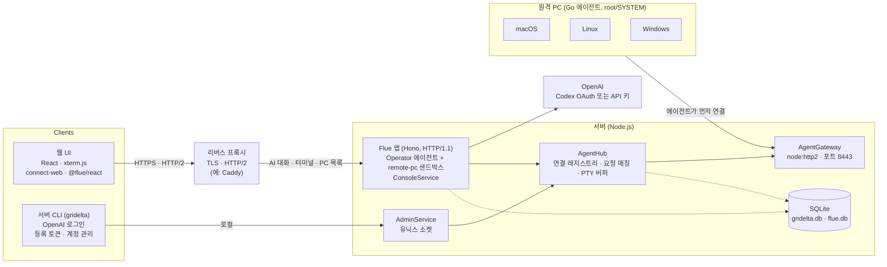

# gridelta: 원격 PC 관리 + AI 컨트롤 시스템 설계 문서

작성일: 2026-10-29 · 구현 결과 반영: 2026-10-29

> **구현 현황:** M1–M3, M5, M6 구현·검증 완료. M4(Windows)는 코드와 단위 테스트까지 하고 실제 Windows PC 확인을 기다리는 중이다. 마일스톤별 결과는 11장, 실행·테스트 방법은 13장. 다음 기능인 스케줄 잡과 상태 기록(M7, M8)의 기획은 14장.

## 1. 개요

원격 PC에 설치한 에이전트를 서버가 관리하고, 사람은 웹 터미널로, AI는 자연어 지시로 그 PC에서 셸 명령을 실행하는 시스템이다. 통신은 ConnectRPC, AI 실행은 Flue로 구현한다. 오픈소스로 공개하며, 배포 환경(도메인·인증서·프록시)은 사용자마다 다르다는 것을 전제로 한다.

### 목표

- 서버–에이전트 구조: 원격 PC에 에이전트를 설치하면 서버에 등록되고 관리 대상이 된다.
- macOS, Linux, Windows 모두에서 셸 명령 실행.
- 웹 UI에서 PC를 선택해 터미널처럼 명령을 입력하고 결과를 본다.
- 서버 CLI에서 OpenAI OAuth 인증을 한다.
- AI에게 자연어로 지시하면 선택한 PC를 조작한다.

### 비목표 (1차 범위 밖)

- 원격 데스크톱(화면 공유, 마우스/키보드 제어)
- 다중 테넌트, 조직/권한 계층 (1차는 단일 관리자)
- 에이전트 자동 업데이트 (2차)
- 서버 수평 확장 (1차는 단일 서버 프로세스)
- PC별 실행 계정 지정 (2차, 5.4)

### 용어

| 용어 | 뜻 |
| --- | --- |
| 에이전트(Agent) | 원격 PC에 설치되는 Go 바이너리(`gridelta-agent`). Flue의 "agent"와 구분하기 위해 코드에서는 `Endpoint` 또는 `node`로 부를 것을 권장 |
| 서버(Server) | 에이전트 연결을 받고 UI·AI·CLI에 기능을 제공하는 Node.js 프로세스 |
| AI 에이전트 | Flue로 정의한 LLM 에이전트. 원격 PC를 샌드박스로 사용 |
| 세션 | 웹 터미널의 PTY 세션 1개 |

## 2. 전체 아키텍처

시스템은 Go 에이전트, Node.js 서버, 웹 UI, 서버 CLI 네 부분이다. 사람의 터미널 입력과 AI의 명령 모두 서버의 AgentHub를 거쳐 에이전트의 bidi 스트림으로 내려간다.



에이전트가 서버로 먼저 연결하므로 원격 PC에는 인바운드 포트가 필요 없다. 웹 UI는 터미널·PC 목록에 Connect API(`ConsoleService`)를, AI 대화에 Flue HTTP 라우트를 쓰며, 둘 다 같은 Flue 앱(메인 포트)에서 제공한다. 메인 포트 앞의 리버스 프록시가 필요한 이유는 6.1에 있다.

| 구성 | 언어/런타임 | 주요 라이브러리 |
| --- | --- | --- |
| 에이전트 | Go 1.27 | connect-go v2, aymanbagabas/go-pty (unix: creack/pty, windows: ConPTY), kardianos/service, golang.org/x/sys/windows, go.yaml.in/yaml/v3, log/slog |
| 서버 | Node.js 26 LTS / TypeScript 7 | @flue/runtime, Hono, Vite 8, @connectrpc/connect-node 2, node:sqlite + drizzle-orm 1.0 rc, @earendil-works/pi-ai, @node-rs/argon2, pino, valibot |
| 웹 UI | TypeScript / React 19 | Vite 8, @connectrpc/connect-web 2, @xterm/xterm 6, @flue/react, Tailwind 4 |
| CLI | TypeScript / Node.js 26 | commander 15, @clack/prompts, @connectrpc/connect-node, @earendil-works/pi-ai. 빌드 없이 Node 26 의 타입 제거로 TS 소스를 바로 실행 |
| 프로토콜 | Protobuf | buf CLI 1.75 (buf.gen.yaml v2), protoc-gen-go, protoc-gen-connect-go (v2), protoc-gen-es 2 |
| 개발·테스트 | — | pnpm 12 (catalogs), Vitest 5, go test, docker compose + Playwright (e2e) |
| 배포 앞단 | — | 리버스 프록시 (예시 설정은 Caddy로 제공) |

- 버전은 2026-10-29에 확인한 기준이다. 정확한 버전은 pnpm catalog와 `go.mod`로 고정한다.
- Flue(2026-02 시작, 메이저 버전이 빠르게 바뀜)와 drizzle-orm 1.0 rc는 정확한 버전으로 고정하고, 올릴 때는 변경 내역을 확인한다.
- 처음 고른 것 중 아직 쓰지 않은 것: TanStack Router·Query, connect-query, shadcn/ui, zustand(화면이 하나라 React 상태와 Tailwind 로 충분), tsdown(CLI 빌드 불필요), Biome, goreleaser(크로스 컴파일은 `make agents`), pino·valibot.

## 3. 저장소 구조

모노레포 하나에 proto, Go 에이전트, TS 서버·웹·CLI를 둔다. proto가 단일 진실 원천이며 Go/TS 코드는 Buf로 생성한다.

```
gridelta/
├─ proto/gridelta/v1/         # .proto 원본 (buf 모듈). 프로토콜의 단일 진실 원천
│  ├─ gateway.proto           # 에이전트 ↔ 서버
│  ├─ console.proto           # 웹 ↔ 서버
│  └─ admin.proto             # CLI ↔ 서버 (유닉스 소켓)
├─ buf.yaml / buf.gen.yaml
├─ tools/go.mod               # protoc-gen-go, protoc-gen-connect-go 버전 고정
├─ Makefile                   # generate, lint-proto, agent, agents(크로스 컴파일), test-e2e
├─ agent/                     # Go 모듈 (go 1.27)
│  ├─ cmd/gridelta-agent/     # enroll / run / install / uninstall / start / stop / status
│  ├─ internal/conn/          # 연결·재연결·하트비트·디스패치, TLS 지문 고정
│  ├─ internal/exec/          # 단발 명령 (unix: 프로세스 그룹, windows: Job Object)
│  ├─ internal/fs/            # 파일 작업
│  ├─ internal/pty/           # PTY 세션 (go-pty)
│  ├─ internal/paths/         # POSIX ↔ Windows 경로 변환
│  ├─ internal/winjob/        # Windows Job Object
│  ├─ internal/config/        # 설정 파일
│  └─ gen/                    # 생성 코드 (커밋)
├─ packages/proto/            # TS 생성 코드 (@gridelta/proto), server·web·cli 공용
├─ server/
│  ├─ src/app.ts              # Flue 앱 라우터 (Hono). 게이트웨이·AdminService 기동, provider 등록
│  ├─ src/db.ts               # Flue 대화 저장소 (Flue 규약 파일)
│  ├─ src/config.ts           # 환경변수 (13장)
│  ├─ src/gateway/            # AgentGateway (node:http2)
│  ├─ src/hub/                # AgentHub, PtySession(링버퍼)
│  ├─ src/rpc/                # ConsoleService, AdminService, 디버그 라우트
│  ├─ src/agents/operator.ts  # Flue AI 에이전트
│  ├─ src/sandboxes/remote-pc.ts  # Flue 샌드박스 어댑터
│  ├─ src/ai/                 # 승인 정책·대기열, 모델 설정, e2e 용 가짜 모델
│  ├─ src/auth/               # 웹 로그인, 등록 토큰, OAuth 저장·갱신, 암호화
│  ├─ src/store/              # 앱 DB (drizzle 스키마). DB 접근은 이 안에서만
│  └─ drizzle/                # 마이그레이션 (drizzle-kit generate)
├─ cli/                       # gridelta CLI (bin/gridelta.js → src/main.ts)
├─ web/                       # React + xterm.js + connect-web + @flue/react
├─ docker/                    # e2e 구성(compose.yaml, e2e.sh, web-e2e/), 로컬 실행(up.sh)
├─ deploy/Caddyfile           # 리버스 프록시 예시
└─ docs/
```

- 패키지 매니저: pnpm workspace (packages/proto, server, cli, web). 공통 의존성 버전은 catalog로 맞춘다.
- 태스크 실행: pnpm 스크립트(`pnpm -r`, `--filter`)와 Go·buf용 Makefile. 별도 모노레포 도구(turborepo 등)는 필요해질 때 도입한다.
- 코드 생성: `make generate`. Go 플러그인은 `tools/go.mod`, TS 플러그인은 루트 devDependency 로 버전을 고정하고, buf 는 `go run ...@v1.75.0` 으로 실행한다(buf 가 요구하는 protobuf 버전이 달라 같은 모듈에 두지 않음). TS 는 `import_extension=ts` 로 생성해 Node 가 바로 실행할 수 있다. 생성 코드는 커밋한다.
- 에이전트 빌드: `make agents` 로 darwin/arm64, darwin/amd64, linux/amd64, linux/arm64, windows/amd64 를 크로스 컴파일한다(goreleaser 는 배포 단계에서 검토).
- pnpm 12 는 설치 스크립트를 기본으로 막으므로 `pnpm-workspace.yaml` 의 `allowBuilds` 에 허용 목록을 둔다.

## 4. ConnectRPC 프로토콜 설계

에이전트는 서버로 bidi 스트림 하나를 열고, 서버는 그 스트림으로 요청을 내려보낸다. 요청과 응답은 `request_id`로 짝을 맞춘다. 브라우저용 API는 unary와 서버 스트리밍만 쓴다.

### 4.1 서비스 구분

| 서비스 | 호출자 | 전송 | 스트리밍 |
| --- | --- | --- | --- |
| `AgentGateway` | 에이전트(Go) | HTTP/2 + TLS (8443) | bidi 스트림 1개 |
| `ConsoleService` | 웹 UI | 리버스 프록시 경유 HTTPS, 브라우저 구간 HTTP/2 | unary + 서버 스트림 |
| `AdminService` | CLI | 로컬 전용(유닉스 소켓) | unary |

- connect-web은 브라우저 제약 때문에 클라이언트/bidi 스트리밍을 지원하지 않는다(2026-10 기준 변화 없음). 그래서 터미널 입력은 unary, 출력은 서버 스트림으로 나눈다.
- 브라우저 구간은 HTTP/2가 필수다. HTTP/1.1이면 도메인당 연결이 6개 안팎으로 제한되는데, `WatchEndpoints`, `WatchApprovals`, 터미널 탭마다의 `AttachTerminal`이 연결을 계속 점유해 입력 요청이 막힌다.

### 4.2 메시지와 RPC

정확한 정의는 `proto/gridelta/v1/*.proto` 가 기준이다. 여기서는 구조만 요약한다. 경로 필드는 모두 POSIX 형식이다(5.3).

**gateway.proto** — `AgentGateway.Connect`(bidi) 와 `Enroll`(unary).
- 에이전트 → 서버 `AgentMessage`: `Hello`(첫 메시지, `pty_session_ids` 로 살아 있는 PTY 세션 목록 포함), `Heartbeat`, `Response`, `PtyOutput`, `PtyExit`.
- 서버 → 에이전트 `ServerMessage`: `Welcome`, `Request`, `PtyInput`, `PtyResize`, `Ping`.
- `Request.op`: `exec`, `cancel`, `fs_read`/`fs_write`/`fs_stat`/`fs_readdir`/`fs_mkdir`/`fs_rm`, `pty_open`/`pty_close`. `Response` 는 결과 또는 `Error{code, message}` (`not_found`, `permission_denied`, `invalid_argument`, `unsupported`, `too_large`, `canceled`, `internal`).
- `Connect` 는 `Authorization: Bearer <credential>` 로 인증한다. 인증 실패는 `unauthenticated`.

**console.proto** — 웹 전용, unary 와 서버 스트림만.
- PC: `ListEndpoints`, `WatchEndpoints`(구독 직후 현재 목록, 이후 변화)
- 터미널: `OpenTerminal`, `ListTerminals`(새로고침 후 탭 복원), `AttachTerminal(from_seq)`, `SendInput(client_id, input_seq)`, `ResizeTerminal`, `CloseTerminal`
- 승인: `WatchApprovals`, `DecideApproval`, `SetApprovalPolicy`
- AI 설정: `GetAiSettings`, `UpdateAiSettings`

**admin.proto** — CLI 전용, 유닉스 소켓(0600)에서만 수신. 소켓 권한이 곧 인증이다.
- `CreateEnrollToken`, `ListEndpoints`, `RevokeEndpoint`, `CreateUser`, `StoreOAuthToken`, `DeleteOAuthToken`, `GetAuthStatus`

AI 대화 자체는 Flue 가 제공하는 HTTP 라우트(8.1)와 `@flue/react` 의 `useFlueAgent` 훅을 그대로 쓴다. Connect 로 다시 감싸지 않는다.

### 4.3 규칙

- **상관 id**: 서버가 `request_id`를 발급하고, 에이전트는 응답에 그대로 돌려준다. 서버는 `Map<request_id, {resolve, reject, timer}>`로 대기한다. 모든 `Request`는 정확히 하나의 `Response`를 받는다(`pty_close`, `fs_write` 등은 `ok`).
- **취소**: `CancelRequest`도 하나의 `Request`이므로 자신의 `Response`를 받는다. 대상이 실행 중이면 `ok`, 이미 끝났거나 없으면 `not_found`. 취소된 대상 exec는 프로세스를 정리한 뒤 `Error{code: "canceled"}`로 응답하며, 서버는 abort 시점에 이미 pending을 지웠으므로 이 응답을 버린다.
- **동시성**: 에이전트는 요청마다 goroutine으로 처리하고, 스트림 송신은 단일 writer goroutine(채널)으로 직렬화한다.
- **크기 상한**:
  - 메시지 하나는 4 MiB 이하. 양쪽 모두 수신 상한을 4 MiB로 설정한다(connect-go `WithReadMaxBytes`, connect-node `readMaxBytes`).
  - `exec` 출력은 stdout과 stderr를 합쳐 `exec_output_limit`(기본 1 MiB, 설정 최대 3 MiB)까지 담고 넘치면 `truncated`. 나머지 1 MiB는 메시지 오버헤드 여유분이다. 모델 컨텍스트에 넣을 출력으로는 1 MiB도 충분히 크다.
  - 파일 읽기·쓰기는 3 MiB 이하만 지원하고 넘으면 `too_large`. 큰 파일 전송은 2차 범위(청크 분할).
  - PTY 출력은 32 KiB 단위로 나눠 보내므로 상한과 무관하다.
- **버전**: 서버는 `Hello.agent_version`이 최소 버전보다 낮으면 `Welcome`을 보내지 않고 `failed_precondition` 에러로 스트림을 닫는다. 에이전트는 이 에러를 받으면 짧은 백오프 대신 1시간 간격으로만 재시도한다. 필드는 추가만 하고 번호 재사용 금지.
- **하트비트**: 서버가 `Welcome.ping_interval_ms`(기본 15초) 간격으로 `Ping`을 보내고, 에이전트는 같은 `nonce`의 `Heartbeat`로 답한다. 서버는 45초 동안 에이전트에게서 아무 메시지도 받지 못하면 연결을 끊고 오프라인 처리한다. 에이전트도 45초 동안 아무것도 받지 못하면 스스로 끊고 재연결한다. HTTP/2 PING(5.1)은 죽은 TCP 연결만 잡으므로 애플리케이션 수준 하트비트도 유지한다.

## 5. 에이전트 (Go) 설계

에이전트는 root/SYSTEM 권한의 OS 서비스로 상주하며 서버에 아웃바운드 연결을 유지하고, 받은 요청을 실행해 결과를 돌려주는 단일 바이너리다.

### 5.1 연결 수명주기

1. 시작 시 설정 파일에서 서버 URL과 자격 증명을 읽는다. 없으면 `gridelta-agent enroll --server <url> --token <등록토큰> [--ca-fingerprint <sha256>]`으로 먼저 등록한다.
   - `gridelta enroll-token create`가 이 명령줄을 통째로 출력한다. 서버가 자체 서명 인증서를 쓰면 `--ca-fingerprint`가 포함되고, 에이전트는 첫 접속부터 그 지문으로 서버를 검증해 설정 파일에 저장한다. 공인 인증서면 생략하고 OS 신뢰 저장소로 검증한다.
   - 등록이 끝나면 `Enroll`이 준 `agent_id`와 `credential`을 설정 파일에 쓴다. 이후 `Connect`는 `Authorization: Bearer <credential>` 헤더로 인증한다.
2. connect-go v2 클라이언트로 `AgentGateway.Connect`를 연다. 첫 메시지로 `Hello` 전송.
   - 전송: 표준 라이브러리 `http.Transport`에 `ForceAttemptHTTP2: true`(사용자 TLS 설정을 쓰면 이게 없을 때 HTTP/1.1로 떨어져 bidi가 실패함), `HTTP2: &http.HTTP2Config{SendPingTimeout, PingTimeout, WriteByteTimeout}`로 연결 상태 확인.
   - `http.Client.Timeout`은 0으로 둔다(스트림 전체에 걸리기 때문). 취소는 context로 한다. 리다이렉트는 거부한다.
3. 수신 루프: `Request`마다 goroutine을 띄워 처리하고, 결과는 송신 채널로 보낸다.
4. 끊기면 지수 백오프(1s → 최대 60s, full jitter, 30초 이상 연결이 유지됐으면 초기화)로 재연결한다. 백오프는 라이브러리 없이 직접 구현한다. 서버가 `failed_precondition`(버전) 이나 `unauthenticated`(폐기된 자격 증명) 로 거부하면 1시간 간격으로만 재시도한다. 실행 중이던 exec는 계속 돌되 결과는 버린다.
5. PTY 세션은 연결이 아니라 에이전트 프로세스에 속한다. 잠깐 끊겼다 다시 붙으면 그대로 이어지고, 30초 안에 다시 연결되지 않으면 모두 닫는다. 재연결 때 `Hello.pty_session_ids` 로 살아 있는 세션을 알려, 서버가 에이전트 재시작으로 사라진 세션을 종료 처리하게 한다.

### 5.2 기능별 구현

| 기능 | 구현 | 비고 |
| --- | --- | --- |
| exec (unix) | `exec.CommandContext(shell, "-lc", cmd)`, `SysProcAttr{Setpgid: true}` | 취소·타임아웃 시 `cmd.Cancel`로 프로세스 그룹에 SIGTERM → 2초 후 SIGKILL. `cmd.WaitDelay`로 손자 프로세스가 파이프를 쥐고 있어도 `Wait`가 멈추지 않게 함 |
| exec (windows) | `powershell.exe -NoProfile -NonInteractive -Command <cmd>` 기본, `shell: cmd.exe` 면 `/C` | Job Object(`KILL_ON_JOB_CLOSE`). 프로세스를 `CREATE_SUSPENDED` 로 띄워 Job 에 넣은 뒤 ntdll `NtResumeProcess` 로 재개하므로, 할당 전에 손자 프로세스가 빠져나가는 틈이 없다 (`internal/winjob`) |
| 파일 | `os` 패키지 직접 사용 | 경로는 에이전트에서 OS 경로로 변환 (5.3) |
| PTY | `github.com/aymanbagabas/go-pty` (unix: creack/pty, windows: ConPTY를 한 API로) | 로그인 셸(`-l`), `TERM=xterm-256color`. 출력 32 KiB 단위로 전송. 닫을 때 unix 는 프로세스 그룹 전체, Windows 는 exec 와 같은 Job Object 방식으로 자식까지 정리 |
| 서비스 등록 | `github.com/kardianos/service` | macOS LaunchDaemon, Linux systemd 시스템 유닛, Windows LocalSystem 서비스(실패 시 재시작). systemd 는 기본 유닛의 `RestartSec=120` 대신 5초 재시작·`network-online.target` 이후 시작하는 유닛 템플릿을 쓴다 |
| 설정 파일 | `go.yaml.in/yaml/v3` | `gopkg.in/yaml.v3`는 아카이브됨. API 동일 |
| 로깅 | `log/slog` | 로그 회전은 OS(journald, newsyslog)에 맡김 |

### 5.3 경로 규칙

Flue 샌드박스는 POSIX 경로(`/` 구분)를 전제로 한다. 프로토콜의 모든 경로는 POSIX 형식이고, Windows 에이전트는 다음 규칙으로 변환한다.

| POSIX (프로토콜) | Windows | 비고 |
| --- | --- | --- |
| `/c/Users/me/file.txt` | `C:\Users\me\file.txt` | 드라이브 문자는 소문자 한 글자 세그먼트. 입력은 대문자 `/C/...`도 허용 |
| `/c` | `C:\` | 드라이브 루트 |
| `/unc/server/share/dir` | `\\server\share\dir` | UNC 경로. `unc`는 세 글자라 드라이브 세그먼트와 겹치지 않음 |
| `/` | (가상 루트) | `readdir("/")`는 존재하는 드라이브(`c`, `d`, …)와 `unc`를 돌려줌. `stat("/")`는 디렉터리. 쓰기·삭제는 `permission_denied` |

- 에이전트→서버(`Hello.home_dir`, 목록 결과)는 반대로 변환한다. `\\?\C:\...`처럼 긴 경로 접두사가 붙은 경로는 접두사를 떼고 변환하며, `\\?\UNC\server\share`는 `/unc/server/share`로 바꾼다.
- 드라이브 문자 없는 상대 경로(`C:foo`)와 장치 경로(`\\.\PIPE\...`)는 지원하지 않고 `invalid_argument`로 거부한다.
- `..`는 변환 전에 POSIX 기준으로 정규화한다. `/c/..`는 `/`가 된다.
- 변환 함수는 위 표의 모든 행을 양방향 테스트한다.

### 5.4 실행 권한

- 에이전트는 root(macOS·Linux) / LocalSystem(Windows)으로 실행한다. 설치에는 관리자 권한이 필요하다.
- 1차에서는 exec·PTY·파일 작업 모두 에이전트 권한(root/SYSTEM) 그대로 실행한다. 웹 터미널과 AI가 root 셸을 얻으므로 승인 정책(8.5)과 감사 로그(10장)를 전제로 한다.
- 2차: PC별 "실행 계정" 설정을 두고, 지정한 OS 사용자로 권한을 낮춰 셸을 연다(unix: `SysProcAttr.Credential`, windows: 사용자 토큰).
- Windows는 서비스가 session 0에서 돈다. 이 상태에서 ConPTY가 정상 동작하는지 M4에서 가장 먼저 확인한다.
- 환경변수: exec는 에이전트 프로세스의 환경을 상속하되, 에이전트 자격 증명 관련 변수는 제거한다. root로 실행되므로 `HOME`은 root의 홈(`/var/root`, `/root`, `systemprofile`)이 되며 `Hello.home_dir`도 그 값을 보낸다.

### 5.5 설정 파일

```yaml
# unix: /etc/gridelta/agent.yaml (root 소유, 0600)
# windows: %ProgramData%\gridelta\agent.yaml (SYSTEM·Administrators만 접근)
server_url: https://grid.example.com:8443
agent_id: 019a3c5e-...          # UUIDv7, Enroll 때 서버가 발급
credential: <서버가 발급한 비밀 토큰>
ca_fingerprint: ""              # 자체 서명 인증서일 때 등록 시 고정한 CA 지문 (10장)
shell: ""                       # 비우면 OS 기본
exec_output_limit: 1048576      # stdout+stderr 합계, 최대 3145728 (4.3)
```

## 6. 서버 설계

서버는 Node.js 단일 프로세스로, Flue 앱(메인 포트)·AgentGateway(8443)·AdminService(유닉스 소켓)를 함께 띄운다. 세 서버가 같은 AgentHub 인스턴스를 공유하며, 모든 원격 작업은 AgentHub 하나를 거친다.

### 6.1 프로세스 구성

Flue가 빌드한 서버(`dist/server.mjs`)는 `@hono/node-server`로 `PORT`(기본 3000)에 **HTTP/1.1, 평문**으로 뜨며 서버를 교체할 공식 방법이 없다. 그래서 다음과 같이 구성한다.

| 포트 | 서버 | 내용 |
| --- | --- | --- |
| 메인 (프록시 뒤, 기본 3000) | Flue 빌드 서버 | Flue 에이전트 라우트, `ConsoleService`, 웹 정적 파일, 웹 로그인 |
| 8443 | `node:http2` `createSecureServer` + `connectNodeAdapter` | `AgentGateway` (bidi에 HTTP/2 필수) |
| 유닉스 소켓 | `node:http` + `connectNodeAdapter` | `AdminService` (CLI 전용) |

- **메인 포트 앞에는 리버스 프록시가 필요하다.** 브라우저 구간에 TLS와 HTTP/2를 제공하기 위해서다(4.1). 프록시→Flue 구간은 HTTP/1.1이어도 된다. 프록시는 스트리밍 응답을 버퍼링하지 않고 긴 연결 타임아웃을 허용해야 한다. 저장소에 Caddy 예시 설정을 제공한다.
- **ConsoleService**는 Flue의 Hono 앱 안에 `/rpc/<서비스>/<메서드>` 로 마운트한다. `createConnectRouter()` 의 핸들러마다 `universalServerRequestFromFetch` → 핸들러 → `universalServerResponseToFetch` 로 Hono 라우트에 붙인다. `createFetchHandler` 는 요청별 context 값(로그인 사용자)을 넘길 방법이 없어서 쓰지 않았다. 서버 스트림도 HTTP/1.1 에서 동작함을 확인했다.
- **AgentGateway**와 **AdminService**는 `app.ts`의 최상위 부수 효과로 띄운다. Vite 개발 모드 재로드 시 중복 listen을 막는 가드(`globalThis` 플래그)를 두며, AgentHub·Store 같은 싱글턴도 같은 방식으로 하나만 만든다. 인증서는 서버 설정으로 경로를 지정하거나, 프록시가 TLS를 종료하고 h2c로 전달하게 할 수 있다(배포 환경에 따라 선택, 10장).
- 서버 진입점을 직접 작성해 Flue 앱을 감싸는 방식(`http2.createSecureServer({ allowHTTP1: true })` + Flue fetch 핸들러)도 가능하지만 Flue가 지원하지 않는 내부 API에 의존하므로 쓰지 않는다.

### 6.2 AgentHub

```ts
interface EndpointInfo { id: string; os: 'darwin'|'linux'|'windows'; hostname: string; homeDir: string; online: boolean; lastSeen: Date; }

class AgentHub {
  list(): EndpointInfo[];
  get(id: string): EndpointConn | undefined;
  // 요청-응답
  request<T>(id: string, op: RequestOp, opts?: { timeoutMs?: number; signal?: AbortSignal }): Promise<T>;
  // PTY
  openPty(id: string, opts): Promise<PtySession>;   // 출력은 링버퍼(256 KiB) + 구독자
  events: EventEmitter;                             // online/offline/pty-output
}
```

- 연결별로 `pending: Map<requestId, Deferred>`를 유지한다. 같은 agent_id 로 새 연결이 오면 이전 연결을 닫는다.
- **오프라인 에러는 하나로 통일한다.** 호출 시점에 PC가 연결되어 있지 않을 때도, 호출 도중 연결이 끊길 때도 `EndpointOfflineError`로 reject한다. 샌드박스 어댑터는 이를 `SandboxDiedError`로 바꿔 Flue에 넘기고(8.2), `ConsoleService`는 Connect `unavailable` 코드로 바꾼다.
- `signal` abort 시 에이전트에 `CancelRequest`를 보내고 pending을 즉시 reject한다(Flue의 orphan 처리와 맞물림, 8장).
- 에이전트가 `Hello`를 보내면 `os`, `home_dir`, `default_shell`, `hostname`을 `endpoints` 테이블에 갱신한다. PC가 오프라인이어도 마지막 정보를 쓸 수 있게 하기 위함이다(8.2).

**PTY 세션과 링버퍼**

- 세션별 링버퍼(256 KiB)에 `PtyOutput`을 `seq`와 함께 쌓는다. 버퍼가 차면 오래된 청크부터 버린다.
- `AttachTerminal(from_seq)` 처리:
  - `from_seq`가 버퍼에 남아 있으면 그 지점부터 보내고, 이후 실시간 출력을 이어 보낸다.
  - `from_seq`가 이미 밀려났으면 첫 메시지에 `reset: true`를 붙여 버퍼에 남은 가장 오래된 청크부터 보낸다. 클라이언트는 `term.reset()` 후 받은 데이터를 쓴다. 중간부터 재생하면 화면이 깨질 수 있으므로, 서버는 이어서 PTY 크기를 한 줄 줄였다가 되돌려 SIGWINCH를 일으킨다. 전체 화면 프로그램(vim, top)은 이 신호에 화면을 다시 그린다.
  - `from_seq`가 미래 값(서버 재시작 등으로 seq가 초기화됨)이면 `reset`과 같은 방식으로 처리한다.
- 세션은 `CloseTerminal`, 셸 종료(`PtyExit`), 구독자 없이 30분 경과 중 하나로 닫는다. 셸이 종료되면 `TerminalOutput.exit_code`를 담아 스트림을 끝낸다.
- 입력 중복 제거는 탭(`client_id`)별로 한다. 새로고침한 탭은 `input_seq` 를 0부터 다시 세므로 세션 하나에 seq 하나만 두면 새 입력을 모두 버리게 된다(M3 에서 실제로 겪은 버그).
- 에이전트가 끊기면 그 PC 의 세션을 30초 유예하고, 그 안에 돌아오지 않으면 종료 처리한다. 다시 붙을 때 `Hello.pty_session_ids` 에 없는 세션도 종료 처리한다.
- 서버가 재시작되면 링버퍼와 세션 정보는 사라진다. 에이전트 쪽 PTY는 30초 유예 후 정리되므로(5.1), 1차에서는 서버 재시작 시 터미널 세션을 다시 열어야 한다.

### 6.3 저장소 (SQLite)

DB는 SQLite 하나로 가되, 앱 데이터와 Flue 대화 기록은 **파일을 나눈다**. 둘 다 Node 내장 `node:sqlite`를 쓰므로 네이티브 의존성이 없다.

| 파일 | 내용 | 접근 |
| --- | --- | --- |
| `data/gridelta.db` | 아래 앱 테이블 | drizzle-orm 1.0 rc (`drizzle-orm/node-sqlite`), 마이그레이션은 drizzle-kit. `src/store/` 안에서만 접근 |
| `data/flue.db` | Flue 대화 기록 | `src/db.ts`에서 `sqlite('./data/flue.db')` (`@flue/runtime/node`). Flue가 테이블과 포맷 버전을 직접 관리 |

- `src/db.ts`가 없으면 Flue는 메모리 DB를 써서 재시작 시 대화가 사라진다. 반드시 둔다.
- drizzle-orm·drizzle-kit 1.0.0-rc.5 로 고정했다. drizzle-kit 마이그레이션이 `node:sqlite` 에서 동작함을 확인했다(서버 시작 시 `migrate()`). 1.0 에서는 `drizzle({ schema })` 옵션이 없어졌다.

| 테이블 | 주요 컬럼 |
| --- | --- |
| endpoints | id, hostname, os, arch, home_dir, default_shell, agent_version, credential_hash, enrolled_at, last_seen, revoked_at, labels, approval_policy |
| enroll_tokens | token_hash, expires_at, used_at |
| users | id, username, password_hash (1차는 관리자 1명) |
| sessions | token_hash, user_id, created_at, expires_at (웹 로그인 세션, 쿠키 원문은 저장하지 않음) |
| audit_log | id, at, actor(user/ai), endpoint_id, kind(exec/pty/fs), command, exit_code, approval_id |
| approvals | id, endpoint_id, command, requested_by(ai session), status, decided_by, decided_at |
| oauth_tokens | provider(`openai-codex`), credential(암호화한 Pi 자격 증명), key_version, account, expires_at, updated_at |
| settings | key, value (현재 `ai.model`) |

- 비밀번호: argon2id (`@node-rs/argon2`).
- 암호화: `node:crypto` AES-256-GCM. 레코드마다 12바이트 랜덤 IV, 인증 태그 저장, AAD에 provider. 키는 마스터 키에서 HKDF로 파생하고 `key_version`으로 교체에 대비한다.
- 마스터 키: `GRIDELTA_MASTER_KEY`(base64 32바이트) 또는 데이터 디렉터리의 `master.key`. 둘 다 없으면 `master.key` 를 만든다(0600). 이 파일을 잃으면 저장된 OAuth 토큰을 복호화할 수 없어 다시 로그인해야 한다.
- 서버 재시작 시 대기 중이던 승인 요청은 기다리던 AI 호출이 사라졌으므로 `expired` 로 바꾼다.

### 6.4 웹 인증

- 1차: 관리자 계정 + 서버 측 세션. 쿠키에는 세션 id만 담는다(`hono/cookie`, HttpOnly, Secure, SameSite=Strict). 계정은 CLI로 생성.
- 검증 함수 `verifySession()` 하나를 Hono 미들웨어 `requireAuth` 로 `/rpc/*` 와 `/agents/*` 앞에 둔다. 통과한 사용자는 Connect 핸들러에 context 값으로 넘겨 감사 로그에 쓴다. 같은 아이디로 5번 틀리면 1분 잠근다.
- `/agents/operator/:id` 는 인증 뒤에 한 번 더, id 의 앞부분이 등록되어 있고 폐기되지 않은 PC 인지 확인한다.
- **로그인 끄기:** `GRIDELTA_WEB_AUTH=off` 면 `verifySession()` 이 익명 사용자를 돌려줘 모든 기능을 로그인 없이 쓴다. 웹은 로그인 화면과 로그아웃 버튼을 숨기고, 서버는 시작할 때 경고를 남긴다. 서버에 접근할 수 있으면 누구나 모든 PC 의 root 셸을 얻으므로 외부에 노출되지 않은 환경에서만 쓴다. 기본값은 켜짐.
- Flue 라우트는 "대화 URL에 접근할 수 있으면 누구나 대화할 수 있다"는 전제이므로, 인증 미들웨어 없이 노출하지 않는다.

## 7. 웹 터미널 UI 설계

웹 UI는 왼쪽에 PC 목록, 오른쪽에 탭별 터미널과 AI 채팅 패널을 두는 React 단일 페이지 앱이다.

스택: React 19, Vite 8, Tailwind 4, connect-web, xterm.js 6, `@flue/react`. 화면이 하나뿐이라 라우터·상태 관리 라이브러리 없이 React 상태로 만들었고, 선택한 PC 는 URL `?pc=` 로 남긴다. 서버 스트림(`WatchEndpoints`, `AttachTerminal`, `WatchApprovals`)은 끊기면 다시 구독하는 루프로 직접 다룬다. 색은 CSS 변수로 두고 라이트·다크를 지원한다.

### 7.1 화면 구성

- **PC 목록**: `WatchEndpoints` 스트림으로 온라인 상태 실시간 표시. OS 아이콘, 호스트명, 마지막 접속 시각.
- **터미널 탭**: PC 하나에 여러 PTY 세션을 탭으로 연다. `@xterm/xterm` 6 + addon-fit, addon-webgl(컨텍스트 손실 시 DOM 렌더러로 전환), addon-unicode11(한글·이모지 폭), addon-web-links. React 래퍼 없이 자체 `useXterm` 훅으로 생명주기를 관리한다.
- **AI 패널**: 선택한 PC에 대해 Flue AI 에이전트와 대화. `@flue/react`의 `useFlueAgent` 훅을 쓰고, 메시지와 도구 호출 카드(`dynamic-tool` 파트)는 직접 만들었다. PC 별 대화 id 는 localStorage 에 두고 "새 대화" 로 바꾼다. 헤더에서 승인 정책과 모델을 고른다.
- **모델 선택**: 기본값은 `gpt-5.6-sol`. 바꾸면 서버 설정에 저장되고 새 대화부터 적용된다. Flue 가 응답에 모델 정보를 담아 주지 않아, 어느 모델이 답했는지는 화면에 표시하지 않는다.
- **승인 대기열**: AI가 요청한 위험 명령이 뜨면 명령 전문과 대상 PC를 보여주고 승인/거부. Flue에는 승인 기능이 없으므로 `ConsoleService`의 자체 RPC로 구현한다.
- **감사 로그**: 사람·AI가 실행한 명령 이력 조회 (기록은 쌓이지만 조회 화면은 아직 없음).
- 구현하며 알게 된 것: `crypto.randomUUID()` 는 HTTPS(보안 컨텍스트)에서만 있으므로 `getRandomValues` 로 id 를 만든다. 최신 Chromium 의 `scrollIntoView()` 는 Promise 를 돌려주므로 `useEffect` 를 표현식 본문으로 쓰면 React 가 그 값을 정리 함수로 부르다 멈춘다.

### 7.2 터미널 데이터 흐름

1. `OpenTerminal(endpoint_id, cols, rows)` → `session_id`
2. `AttachTerminal(session_id, from_seq=0)` 서버 스트림 구독 → xterm에 write
3. 키 입력: xterm `onData` → 16 ms 동안 모아서 `SendInput` (unary). 탭마다 랜덤 `client_id` 를 만들고, 입력 묶음마다 `input_seq`(0부터 1씩 증가)를 붙인다. 서버는 `(client_id, input_seq)` 로 이미 처리한 입력을 무시하고 성공으로 응답하므로 재시도해도 안전하다. 클라이언트 직렬 큐로 보낸다.
4. 창 크기 변경: `ResizeTerminal` (디바운스 100 ms)
5. 스트림이 끊기면 받은 마지막 `seq + 1`로 재구독한다. `reset: true`를 받으면 화면을 초기화하고 다시 그린다(6.2).
6. `exit_code`가 담긴 메시지를 받으면 탭에 종료 상태를 표시한다.

### 7.3 지연 대응

unary 입력 방식은 키 입력 묶음마다 HTTP 요청이 생긴다. 브라우저–서버 구간이 HTTP/2이면 연결 재사용으로 대부분 충분하다. 참고로 비슷한 웹 터미널(ttyd, Teleport, Coder 등)은 터미널 입출력에 WebSocket을 쓴다. M3에서 체감 지연을 측정해 50 ms를 넘으면 터미널 입출력만 WebSocket(같은 Hono 앱에 마운트, 바이너리 protobuf 프레임)으로 바꾼다. AgentHub의 PtySession 인터페이스는 전송 방식과 무관하게 설계한다.

측정 결과: docker 안에서 브라우저 → 서버(HTTP/1.1 직접, 프록시 없음) → 에이전트 경로로 키를 누른 뒤 에코가 오기까지 중앙값 약 26 ms, p90 약 28 ms (16 ms 묶음 포함). 기준 안이라 WebSocket 으로 바꾸지 않았다. 웹 상태 표시줄에 현재 탭의 입력 지연을 보여 준다. 리버스 프록시를 거친 HTTP/2 환경에서는 아직 재지 않았다.

## 8. AI 컨트롤 (Flue)

원격 PC를 Flue의 커스텀 샌드박스로 연결한다. 그러면 Flue 기본 도구(`read`, `write`, `edit`, `bash`, `grep`, `glob`)가 그대로 원격 PC에서 동작하므로, 셸 도구를 따로 만들 필요가 없다.

### 8.1 대화와 PC의 연결

- 에이전트 라우터는 `app.route('/agents/operator', createAgentRouter(Operator))`로 마운트한다(`@flue/runtime/routing`). 제공 라우트: `POST /:id`(메시지 전송, 202), `GET /:id`(스냅샷·롱폴·SSE), `HEAD /:id`, `POST /:id/abort`, `GET /:id/attachments/:aid`.
- Flue 에이전트 인스턴스 id(URL의 `:id`) = `<endpoint_id>:<대화 id>` 형식. 샌드박스 팩토리는 `createSandbox({ id })`로 이 id를 받으므로 앞부분으로 대상 PC를 찾는다. `createSandbox`는 같은 id로 여러 번 불릴 수 있으므로 상태를 두지 않는다.
- 한 대화는 한 PC에 묶인다. 여러 PC를 다루는 작업은 2차 범위(서브에이전트 또는 커스텀 도구로 PC 전환).

### 8.2 샌드박스 어댑터

구현은 `server/src/sandboxes/remote-pc.ts`. 요지는 다음과 같다.

- `createSandbox({ id })`: id 앞부분으로 PC 를 찾고, 마지막 `Hello` 기준 정보(DB)로 `sandboxFromDriver(driver, homeDir)` 를 만든다. PC 가 오프라인이어도 만들어지고, 원격 호출만 실패한다.
- 드라이버의 모든 원격 호출은 `hub.request()` 를 감싼 `call()` 을 거치며, `EndpointOfflineError` 를 `new SandboxDiedError({ operation, reason: 'stopped' })` 로 바꾼다.
- `exec` 는 승인 정책(8.5)을 거친 뒤 `ExecRequest` 로 보낸다. 출력이 잘렸으면 stdout 끝에 안내를 붙이고, 결과와 승인 id 를 감사 로그(`actor=ai`)에 남긴다. `writeFile`·`rm` 도 감사 로그에 남긴다.

`defaultTools`는 `createReadTool`, `createWriteTool`, `createEditTool`, `createBashTool`, `createGrepTool`, `createGlobTool` 6개를 모은 배열이다.

어댑터 계약에서 지킬 것:

- `exec`는 명령이 끝나면 non-zero exit도 `ShellResult`로 resolve한다. reject는 전송 실패와 abort에만 쓴다.
- `timeoutMs`는 에이전트의 `ExecRequest.timeout_ms`로 그대로 전달하고, 에이전트가 시간 초과 시 `exitCode: 124`로 응답한다.
- `signal`은 AgentHub에 넘겨 `CancelRequest`로 실제 프로세스를 죽인다. 어댑터 안에서 별도의 abort race를 만들지 않는다(`sandboxFromDriver`가 이미 처리).
- PC가 오프라인이면(호출 시점이든 도중이든) `SandboxDiedError`로 reject한다. `createSandbox` 자체는 PC가 오프라인이어도 성공한다. 등록되지 않았거나 폐기된 PC일 때만 실패한다.
- `exists`는 파일 부재·권한 문제로는 throw하지 않고 `false`를 돌려준다. Flue 계약의 "절대 throw하지 않음"을 파일 상태에 대한 것으로 해석해, 연결 끊김만은 `SandboxDiedError`로 던진다. 이 경우 Flue 가 어떻게 동작하는지는 아직 확인하지 못했다(12장).
- `FileStat`에서 모르는 값은 가짜로 채우지 않고 생략한다(`FsStatResult`의 optional 필드).
- `rm`은 `recursive`/`force`를 정확히 지키거나, 지원하지 못하면 `SandboxOperationUnsupportedError`를 던진다.
- 드라이버로 들어오는 경로는 POSIX 절대 경로다. Windows 변환은 에이전트에서 한다(5.3).

### 8.3 AI 에이전트 정의

```ts
// server/src/agents/operator.ts (요약)
'use agent';
export function Operator({ id }: AgentProps) {
  useModel(aiModels.current(), { thinkingLevel: 'medium' }); // settings 의 ai.model, 기본 openai-codex/gpt-5.6-sol
  useSandbox(remotePc({ hub, store, approvals }));
  const pc = hub.list().find((e) => e.id === endpointIdOf(id));
  return [/* 운영자 역할, 승인 거부(126) 의미, 대상 PC 의 OS·셸·홈, Windows 면 PowerShell 안내 */].join('\n');
}
```

- 시스템 프롬프트에 대상 PC의 OS·셸을 넣는다. 정보는 AgentHub의 `EndpointInfo`에서 가져온다.
- Flue 에이전트 함수는 동기라서, 현재 모델은 `AiModels` 가 메모리에 들고 있고 바꿀 때만 `settings` 에 저장한다. 인스턴스 id 는 `AgentProps.id` 로 받는다.

### 8.4 Windows 대응

모델은 `bash` 도구 이름 때문에 bash 문법을 쓰기 쉽다. Windows PC에서는 샌드박스의 `tools` 함수로 기본 도구 세트를 교체한다.

- `createReadTool`, `createWriteTool`, `createEditTool`은 그대로 사용(파일 동사만 필요).
- `bash`, `grep`, `glob` 대신 `powershell` 도구 하나. `createBashTool(sandbox)` 를 그대로 쓰고 이름·설명만 바꿨다(실행은 같은 `sandbox.exec`).
- 시스템 프롬프트에 "PowerShell 문법 사용"을 명시.

### 8.5 승인 (사람 확인)

`execWithApproval`이 모든 AI 명령의 관문이다. 에이전트가 root/SYSTEM으로 실행되므로(5.4) 이 관문이 AI 오작동에 대한 주된 방어선이다.

1. 정책 검사(`server/src/ai/policy.ts`): 명령을 `|`, `;`, `&&`, `||` 로 나눠 모든 조각이 읽기 전용 목록(`ls`, `cat`, `du`, `df`, `grep`, `Get-ChildItem` 등)에 있고 출력 리디렉션·명령 치환이 없으면 바로 실행한다.
2. 위험 패턴(`rm -r/-f`, `sudo`, `shutdown`, `reboot`, `mkfs`, `dd of=`, 디스크 도구, `chmod -R`, 패키지 제거, `systemctl stop`, `kill -9`, `git reset --hard`, `del /s`, `Remove-Item -Recurse`, 레지스트리 수정 등)이 하나라도 보이거나 정책이 "항상 승인"이면 `approvals`에 기록하고 UI에 알린다. 파서가 아니라 보수적인 휴리스틱이다.
3. 승인될 때까지 대기(최대 10분). 거부되면 `exitCode: 126`, stderr에 "사용자가 실행을 거부함"을 담아 resolve한다. 모델이 이유를 알고 다른 방법을 찾게 하기 위함.
4. 실행 결과는 모두 `audit_log`에 `actor=ai`로 기록.

승인 정책은 PC별로 `항상 승인`(always) / `위험 명령만`(dangerous) / `자동 실행`(auto) 중 선택. 기본값은 `위험 명령만`. 대화를 중단(abort)하면 대기 중인 승인은 만료 처리한다.

### 8.6 테스트용 모델

`GRIDELTA_AI_FAUX=1` 이면 실제 LLM 대신 Pi 의 faux provider 로 만든 정해진 응답 모델(`faux/scripted`)을 쓴다. 사용자 메시지의 키워드로 도구 호출을 고르고("디스크" → `du`, "지워" → `rm -rf /tmp/gridelta-ai-test`, "파일" → `write`), 도구 결과를 받으면 그대로 답한다. docker e2e 가 키 없이 Flue → 샌드박스 → 에이전트 → 승인 흐름 전체를 확인하는 데 쓴다.

## 9. 서버 CLI와 OpenAI 인증

CLI(`gridelta`)는 서버 호스트에서 실행하는 관리 도구로, OpenAI 로그인·에이전트 등록 토큰 발급·관리자 계정 관리를 맡는다. OpenAI 인증은 Pi(`@earendil-works/pi-ai`)에 이미 구현된 `openai-codex` provider의 OAuth를 그대로 쓴다. 받은 자격 증명은 서버 DB에 암호화해 저장하고, Flue provider가 요청마다 읽어 쓴다.

### 9.1 명령

| 명령 | 동작 |
| --- | --- |
| `gridelta login openai` | OAuth 로그인 (9.2). 기본 PKCE, `--device`로 디바이스 코드 |
| `gridelta logout openai` | 저장된 토큰 삭제 |
| `gridelta auth status` | 로그인 계정, 만료 시각, 현재 provider |
| `gridelta enroll-token create --ttl 1h` | 에이전트 등록용 1회성 토큰 발급. 에이전트에서 실행할 `gridelta-agent enroll ...` 명령줄(자체 서명이면 CA 지문 포함)을 출력 |
| `gridelta endpoints list` / `revoke <id>` | 에이전트 목록, 자격 증명 폐기 |
| `gridelta user create <name>` | 웹 관리자 계정 생성 |

CLI는 commander 15 로 만들고(비밀번호 입력에 @clack/prompts), `AdminService`(유닉스 소켓, `createConnectTransport({ httpVersion: '1.1', nodeOptions: { socketPath } })`)로 서버와 통신한다. 소켓 경로는 `--socket`, `GRIDELTA_ADMIN_SOCKET`, `GRIDELTA_DATA_DIR/admin.sock` 순서로 정한다. 빌드 없이 `bin/gridelta.js` 가 `src/main.ts` 를 Node 의 타입 제거로 바로 실행한다. 서버 docker 이미지에는 `gridelta` 명령으로 들어 있다.

### 9.2 로그인 흐름

Pi `openai-codex` provider의 `auth.oauth.login()`을 CLI에서 호출한다. 엔드포인트·client id·scope는 Pi 구현을 따른다.

1. **기본: 브라우저 PKCE.** CLI 가 로그인 URL 을 출력하고 로컬 콜백(`localhost:1455/auth/callback`)으로 받는다. 이 포트는 Codex CLI와 같으므로 동시에 쓰면 충돌한다. 콜백 서버의 바인드 주소는 `PI_OAUTH_CALLBACK_HOST` 로 바꿀 수 있어, docker 에서는 `0.0.0.0` 과 1455 포트 공개로 호스트 브라우저의 콜백을 받는다.
2. **콜백을 받지 못할 때:** 리디렉션된 URL 을 CLI 에 붙여 넣는다(Pi 지원 방식). 콜백이 먼저 오면 입력 대기는 취소된다.
3. **`--device`: 디바이스 코드.** OpenAI의 비표준 디바이스 흐름(RFC 8628 아님)이며 베타라서, ChatGPT 보안 설정 또는 워크스페이스 관리자가 켜야 쓸 수 있다.
4. 발급된 자격 증명을 `AdminService.StoreOAuthToken`으로 서버에 전달 → `oauth_tokens`에 암호화 저장(6.3).
5. 로그인 URL 의 `originator` 는 Pi 기본값(`pi`)을 쓴다. 다른 값을 넣으면 OpenAI 가 거부할 수 있어 바꾸지 않았다. 실제 ChatGPT 계정 로그인과 모델 호출을 확인했다.

### 9.3 Flue와 연결

provider는 설정으로 고른다.

| provider | 인증 | 모델 | 용도 |
| --- | --- | --- | --- |
| `openai-codex` (기본) | ChatGPT 구독 OAuth (9.2) | `gpt-5.6-*` (기본 `gpt-5.6-sol`) | 일반 사용 |
| `openai` | `OPENAI_API_KEY` | OpenAI API 모델 | 개발(M5), 약관상 API 키가 필요한 사용자 |

서버는 가짜 모델 모드가 아니면 항상 `openai-codex` provider 를 같은 id 로 다시 등록해(`server/src/auth/openai.ts`), 요청마다 `auth.apiKey.resolve()` 에서 DB 의 자격 증명을 읽는다.

- 만료 5분 전이면 `oauth.refresh()` 후 DB 를 갱신하고 `oauth.toAuth()` 로 바꿔 돌려준다. 동시 refresh 는 하나의 Promise 로 묶는다(Pi 의 `CredentialStore` 는 Flue 가 노출하지 않음).
- 로그인하지 않았으면 "OpenAI 로그인이 필요합니다. 서버 호스트에서 `gridelta login openai` 를 실행하세요." 를 던지고, AI 패널에 그대로 보인다.
- 쓸 수 있는 모델 목록은 Pi `openaiCodexProvider().getModels()` 에서 온다(2026-10-29: GPT-5.6 Luna/Sol/Terra, GPT-6 Astra/Luna/Sol, GPT-6.1 Sol).
- 서버가 직접 의존하는 `@earendil-works/pi-ai` 는 Flue 가 쓰는 것과 같은 사본(1.4.0)으로 dedupe 된다.
- `openai` provider(`OPENAI_API_KEY`)는 `GRIDELTA_AI_MODEL=openai/...` 로 쓸 수 있게 열어 두었지만 아직 실제로 시험하지 않았다.
- **약관 주의:** 서버에 상주하는 에이전트가 ChatGPT 구독 토큰을 쓰는 것을 OpenAI가 허용한다는 공식 입장은 확인되지 않았다. 구독 요금제의 사용량 제한도 적용된다. 그래서 `openai`(API 키) provider를 정식 경로로 함께 지원하고, README에 이 점을 밝힌다.

## 10. 보안

서버를 장악하면 연결된 모든 PC의 root 셸을 얻는 구조이므로, 서버·에이전트·AI 세 경로 모두 처음부터 최소 노출과 기록을 전제로 만든다.

| 위협 | 대응 |
| --- | --- |
| 가짜 에이전트 접속 | 1회성 등록 토큰(만료 1시간) → 에이전트별 비밀 자격 증명 발급, 서버에는 해시만 저장. 2차에 mTLS 검토 |
| 가짜 서버(중간자) | TLS 필수, 에이전트는 서버 인증서 검증. 배포 환경에 따라 두 방식을 모두 지원: (1) 공인 도메인 + 공인 인증서(예: Caddy 자동 발급), (2) 자체 서명 인증서 + 등록 시 CA 지문 고정(`ca_fingerprint`) |
| 서버 장악 시 피해 범위 | 에이전트가 root/SYSTEM이므로 피해가 큼 → 서버 호스트 최소 노출, AdminService 로컬 전용, 위험 명령 승인, `revoke`로 즉시 차단. 2차에 PC별 실행 계정(5.4) |
| 웹 UI 탈취 | 관리자 로그인, HttpOnly/Secure/SameSite 쿠키, 로그인 실패 제한. 2차에 TOTP |
| AI 오작동·프롬프트 인젝션 | 명령 출력·파일 내용은 모델 입력이 되므로 그 안의 지시를 따를 수 있음 → 위험 명령 승인(8.5), PC별 정책, 전 명령 감사 로그 |
| 토큰 유출 | OAuth 자격 증명·에이전트 자격 증명 DB 암호화, 에이전트 설정 파일은 root/SYSTEM만 읽기, exec 환경에서 자격 증명 변수 제거, 로그(pino)에서 토큰 필드 redact |
| 관리 API 노출 | `AdminService`는 유닉스 소켓에서만 수신 |
| 자격 증명 폐기 | `endpoints revoke` 시 즉시 연결 종료 및 재접속 거부 |

로그 원칙: 사람·AI의 모든 exec와 PTY 세션 시작/종료를 `audit_log`에 남긴다. PTY 입력 내용 전체 기록은 비밀번호가 남을 수 있어 1차에서는 하지 않는다.

## 11. 구현 마일스톤 (Claude Code 작업 단위)

마일스톤은 6단계이며, 각 단계는 끝에 직접 확인할 수 있는 완료 기준을 둔다. 결과의 "확인" 은 docker e2e(13장)로 자동 검증한 것이다.

| 단계 | 커밋 | 상태 |
| --- | --- | --- |
| M1 | `af157d7` | 완료 |
| M2 | `6c09a92` | 완료 (공인 인증서 방식은 미확인) |
| M3 | `cfb0629` | 완료 (프록시 경유 HTTP/2 지연은 미측정) |
| M4 | `595da8d` | 코드·단위 테스트까지. Windows PC 확인 대기 |
| M5 | `fbabf4c` | 완료 (Linux 만, 실제 모델 확인) |
| 웹 로그인 끄기 | `fcecbf1` | 완료 |
| M6 | `b9f30be`, `2f98ab4` | 완료 (토큰 자동 갱신은 미확인) |

### M1. 골격과 왕복 exec

- [x] 모노레포, pnpm workspace(catalog), Go 모듈(go 1.27), buf 설정, `packages/proto`
- [x] `gateway.proto` 최소 버전(Hello, Ping, Exec) 생성
- [x] 서버: `app.ts`에서 AgentGateway(8443, `node:http2`) 기동 + AgentHub(request/응답 매칭)
- [x] 에이전트: connect-go v2 연결·재연결(직접 구현한 백오프)·exec(unix)
- [x] 서버에 임시 디버그 명령으로 `exec` 호출
- [x] 6.1 구성 검증: Flue Hono 앱 안에 Connect 핸들러 마운트(서버 스트림 포함), 개발 모드 재로드 시 8443 중복 listen 방지

완료 기준: 로컬에서 에이전트를 띄우고 서버에서 `uname -a` 결과를 받는다. 에이전트를 죽였다 살리면 자동 재연결된다.

결과: 확인. 비정상 종료 코드·stderr 전달, 타임아웃(124)과 자식 프로세스 정리, 1 MiB 출력 상한, 서버 재시작 후 재연결, `WatchEndpoints` 스트림까지 확인.

### M2. 등록·인증·저장소

- [x] drizzle 1.0 rc 스키마와 drizzle-kit 마이그레이션(`node:sqlite`에서 동작 확인), `src/db.ts`(Flue 저장소)
- [x] 등록 토큰, `Enroll` RPC, 에이전트 자격 증명
- [x] CLI: `enroll-token create`, `endpoints list/revoke`, `user create`, AdminService(유닉스 소켓)
- [x] 에이전트 설정 파일, `gridelta-agent enroll`, OS 서비스 등록(root, LaunchDaemon·systemd 시스템 유닛)
- [x] TLS 두 방식(공인 인증서 / 자체 서명 + CA 지문 고정), Caddy 예시 설정 — 자체 서명만 docker 에서 확인

완료 기준: 새 PC에서 `gridelta-agent enroll` 후 서비스로 상주하고, `revoke` 시 즉시 끊긴다. 공인 인증서와 자체 서명 인증서 두 방식 모두 등록·접속된다.

결과: systemd 가 PID 1 인 Debian 컨테이너에서 서비스 등록(active·enabled), 프로세스를 죽이면 systemd 가 5초 뒤 재시작, revoke 즉시 끊김·재접속 거부를 확인. 사용한 토큰 재사용, 다른 인증서 지문, 위조한 자격 증명은 모두 거부. 자체 서명 방식만 확인했다.

### M3. 웹 터미널

- [x] PTY(unix, go-pty), `ConsoleService` 터미널 RPC, 링버퍼·재접속
- [x] 웹: 로그인, PC 목록(`WatchEndpoints`), xterm.js 6 터미널 탭
- [x] 입력 지연 측정 (50 ms 기준, 7.3) — 프록시 없이 HTTP/1.1 로만 측정

완료 기준: 브라우저에서 `vim`, `top`을 정상 사용하고, 새로고침 후 같은 세션에 재접속된다.

결과: Playwright 로 확인. 한글 입출력, 창 크기 변경 반영, 새로고침 후 이전 출력 복원과 입력 계속, 셸 종료 코드 표시, PTY 시작·종료 감사 로그까지 확인.

### M4. Windows 지원

- [ ] LocalSystem 서비스(session 0)에서 ConPTY 동작 확인 (가장 먼저)
- [x] exec(PowerShell, Job Object와 할당 전 틈 처리), ConPTY, 경로 변환과 테스트 — 경로 변환은 모든 OS 에서 테스트, 나머지는 Windows 용 테스트 코드만 작성
- [ ] Windows 서비스 등록

완료 기준: Windows PC에서 M1–M3 완료 기준을 모두 통과한다.

결과: 미확인. Windows PC 에서 `agent/` 의 `go test ./...`(PowerShell·cmd exec, 타임아웃 시 자식 트리 종료, ConPTY 왕복)를 돌리고, 서비스로 설치해 웹 터미널과 AI 를 확인해야 한다.

### M5. AI 컨트롤

- [x] 파일 RPC(read/write/stat/readdir/mkdir/rm), Cancel
- [x] `remote-pc` 샌드박스 어댑터, `Operator` 에이전트, Windows용 도구 교체
- [x] 승인 흐름(`execWithApproval`, approvals 테이블, UI 대기열)
- [x] 웹 AI 패널 (`useFlueAgent`, 도구 호출 카드)
- [x] 이 단계에서는 키 대신 정해진 응답 모델(8.6)로 확인했다. 실제 모델은 M6 로그인 후 확인

완료 기준: "디스크 사용량이 큰 폴더 5개 알려줘"를 macOS·Linux·Windows에서 각각 수행하고, `rm -rf` 시도는 승인 대기에 걸린다.

결과: Linux 에서 확인. 정해진 응답 모델로 읽기 전용 명령 즉시 실행, `rm -rf` 승인 대기 → 거부(126) → 다시 요청해 승인 → 실제 삭제, write 도구, 새로고침 후 대화 기록, 승인·감사 로그를 확인. 실제 `gpt-5.6-sol` 로도 디스크 질문(모델이 `du` 를 직접 작성해 실행)과 `rm -rf` 승인 거부를 확인. macOS·Windows 는 미확인.

### M6. OpenAI OAuth와 모델 선택

- [x] `gridelta login openai` (Pi `openai-codex`: PKCE 기본, URL 붙여넣기, `--device`)
- [x] 자격 증명 암호화 저장, refresh, `openai-codex` provider 재등록 — refresh 는 아직 실제로 일어나지 않음
- [x] provider·모델 설정(`settings`), 웹 AI 패널 모델 선택 (기본 `gpt-5.6-sol`)

완료 기준: 환경변수 없이 CLI 로그인만으로 M5 시나리오가 동작하고, 토큰 만료 후에도 자동 갱신된다. 웹에서 모델을 바꾸면 다음 대화부터 적용된다.

결과: 실제 ChatGPT 계정으로 로그인해 M5 시나리오 동작, Luna 로 바꾼 새 대화의 응답, 목록에 없는 모델 거부를 확인. 토큰이 만료되지 않아 자동 갱신은 아직 일어나지 않았다.

## 12. 결정 사항, 열린 질문, 참고 자료

### 결정 사항 (2026-10-29)

- 프로젝트 이름은 `gridelta`로 통일 (바이너리 `gridelta-agent`, CLI `gridelta`, proto 패키지 `gridelta.v1`, 설정 경로 `/etc/gridelta`).
- 서버 런타임은 Node.js 26 LTS.
- DB는 SQLite(`node:sqlite`), 앱 DB와 Flue DB는 파일 분리. ORM은 drizzle-orm 1.0 rc(버전 고정).
- OpenAI 인증은 Pi에 구현된 `openai-codex` OAuth 사용. 로그인 기본은 PKCE + URL 붙여넣기, 디바이스 코드는 `--device`. `OPENAI_API_KEY`(`openai` provider)도 정식 지원.
- 기본 모델은 `gpt-5.6-sol`, 웹 UI에서 선택 가능.
- 에이전트는 root/SYSTEM으로 실행. 1차는 셸도 root로 열고, PC별 실행 계정은 2차.
- Flue 서버가 HTTP/1.1이므로 메인 포트 앞에 리버스 프록시를 둔다. AgentGateway는 8443 별도 `node:http2` 서버.
- 도메인·인증서는 배포하는 사람마다 다르므로 공인 인증서와 자체 서명(CA 지문 고정) 두 방식을 모두 지원.
- 웹 로그인은 기본 켜짐, `GRIDELTA_WEB_AUTH=off` 로 끌 수 있다.
- CLI 는 빌드하지 않고 Node 26 의 타입 제거로 TS 를 바로 실행한다.
- 동작 확인은 docker(서버, systemd Debian·Alpine 에이전트, Playwright 브라우저)로 한다.

### 열린 질문

- [ ] ChatGPT 구독 토큰을 서버 상주 에이전트에 쓰는 것이 OpenAI 약관상 허용되는가? (확인 전까지 README에 위험 고지, API 키 경로 유지)
- [ ] LocalSystem 서비스(session 0)에서 ConPTY가 정상 동작하는가? (M4)
- [ ] `CREATE_SUSPENDED` + `NtResumeProcess` 로 Job Object 할당 전 틈을 막는 방식이 실제 Windows 에서 동작하는가? (M4)
- [x] drizzle-kit 마이그레이션이 `node:sqlite`에서 동작하는가? → 동작한다 (M2)
- [x] `SandboxDiedError` 생성자 시그니처 → `{ operation, reason: 'stopped' | 'probe_silent' }`
- [ ] Flue가 `SandboxDiedError`를 받으면 대화를 어떻게 처리하는가? `exists`가 연결 끊김에 throw하는 것이 허용되는가? (대화 도중 PC 를 끊어 보는 시험이 필요)
- [ ] 모델별 차이와 용도 (Codex 목록: GPT-5.6 Luna/Sol/Terra, GPT-6 Astra/Luna/Sol, GPT-6.1 Sol)
- [ ] 리버스 프록시(Caddy) 경유 HTTP/2 에서의 동작·지연, 공인 인증서 방식 등록
- [ ] OAuth 토큰 자동 갱신이 실제 만료 시점에 동작하는가
- [ ] `openai` provider(`OPENAI_API_KEY`) 경로
- [ ] 여러 PC를 한 대화에서 다루는 기능이 필요한가? (2차 범위로 둠)

### 참고 자료

- [Flue — Sandboxes](https://flueframework.com/docs/guide/sandboxes/)
- [Flue — Sandbox Adapter API](https://flueframework.com/docs/reference/sandbox-api/)
- [Flue — Models](https://flueframework.com/docs/guide/models/)
- [Flue — Routing](https://flueframework.com/docs/guide/routing/)
- [Flue — Database](https://flueframework.com/docs/guide/database/)
- [Flue — Deploy (Node)](https://flueframework.com/docs/ecosystem/deploy/node/)
- [Flue — React](https://flueframework.com/docs/guide/react/)
- [Flue — Getting Started](https://flueframework.com/docs/guide/getting-started/)
- [Pi providers](https://pi.dev/docs/latest/providers)
- [OpenAI Codex 인증](https://learn.chatgpt.com/docs/auth)
- [ConnectRPC 문서](https://connectrpc.com/docs/introduction)
- [connect-go v2 가이드](https://github.com/connectrpc/connect-go/blob/main/docs/v2-guide.md)
- [Connect Node 서버 플러그인](https://connectrpc.com/docs/node/server-plugins/)
- [Node.js node:sqlite](https://nodejs.org/api/sqlite.html)

## 13. 실행과 테스트

### 13.1 직접 써 보기 (docker)

```sh
./docker/up.sh          # 서버 + 에이전트 2대 (systemd Debian, Alpine). 웹 로그인 없음, 실제 OpenAI 모델
open http://127.0.0.1:3900
docker compose -p gridelta-local -f docker/compose.yaml exec server gridelta login openai   # AI 를 쓰려면
docker compose -p gridelta-local -f docker/compose.yaml exec server gridelta auth status
./docker/up.sh down     # 내리기 (데이터도 지움)
```

### 13.2 자동 검증

| 명령 | 내용 |
| --- | --- |
| `cd agent && go test ./...` | 에이전트 단위 테스트 (exec, PTY, 파일, 경로 변환, 설정, TLS 지문) |
| `cd server && npx vitest run` | 서버 단위 테스트 (AgentHub, PtySession, 저장소, 승인 정책, 암호화, 모델 설정) |
| `pnpm -r typecheck` | TS 타입 검사 (proto, server, cli, web) |
| `make test-e2e` | docker e2e: 서버와 에이전트 2대를 새로 띄워 M1–M3·M5·M6 완료 기준과 로그인 끄기까지 45개 항목을 확인. Playwright 브라우저로 웹 터미널과 AI 패널을 직접 조작한다 |

### 13.3 서버 환경변수

| 변수 | 기본값 | 뜻 |
| --- | --- | --- |
| `PORT` | 3000 | 메인 포트 (Flue 빌드 서버) |
| `GRIDELTA_DATA_DIR` | `./data` | `gridelta.db`, `flue.db`, `admin.sock`, `master.key` 위치 |
| `GRIDELTA_GATEWAY_PORT` | 8443 | 에이전트 게이트웨이 |
| `GRIDELTA_GATEWAY_URL` | `https://localhost:8443` | 등록 명령줄에 넣는 게이트웨이 주소 |
| `GRIDELTA_TLS_CERT` / `GRIDELTA_TLS_KEY` | 없음 | 둘 다 있으면 게이트웨이를 TLS 로, 없으면 h2c (프록시가 TLS 를 맡을 때) |
| `GRIDELTA_TLS_SELF_SIGNED` | 꺼짐 | `1` 이면 등록 명령줄에 인증서 지문을 넣는다 |
| `GRIDELTA_ADMIN_SOCKET` | `$DATA_DIR/admin.sock` | CLI 용 유닉스 소켓 |
| `GRIDELTA_WEB_DIR` | `../web/dist` | 웹 UI 빌드 결과 |
| `GRIDELTA_WEB_AUTH` | 켜짐 | `off` 면 웹 로그인 없이 모든 기능 (6.4) |
| `GRIDELTA_AI_MODEL` | `openai-codex/gpt-5.6-sol` | 기본 모델. 웹에서 고른 값이 있으면 그 값이 우선 |
| `GRIDELTA_AI_FAUX` | 꺼짐 | `1` 이면 테스트용 정해진 응답 모델 (8.6) |
| `GRIDELTA_MASTER_KEY` | 없음 | OAuth 토큰 암호화 키 (base64 32바이트). 없으면 `master.key` |
| `GRIDELTA_MIGRATIONS_DIR` | `./drizzle` | DB 마이그레이션 폴더 |
| `GRIDELTA_DEBUG` | 꺼짐 | `1` 이면 인증 없는 `/_debug/exec` 를 연다. 테스트 전용 |
| `PI_OAUTH_CALLBACK_HOST` | `127.0.0.1` | `gridelta login openai` 콜백 서버 바인드 주소 (Pi) |

## 14. 스케줄 잡과 상태 기록 (기획, 2026-10-30)

정해진 시각에 PC 들에서 명령이나 AI 작업을 실행하고, 그 결과로 PC 의 상태(디스크, 메모리, 서비스 등)를 모아 저장하는 기능이다. 사람과 AI 모두 잡을 만들 수 있다.

### 14.1 용어

| 용어 | 뜻 |
| --- | --- |
| 잡(job) | 무엇을·어디서·언제 실행할지 정의한 것 |
| 회차(run) | 잡이 한 번 실행된 것 |
| 결과(result) | 회차 안에서 PC 하나의 실행 결과 |
| 상태 기록(record) | PC 별로 남기는 이름 + JSON 값. 잡·AI 가 남긴다 |

### 14.2 잡 정의

| 항목 | 내용 |
| --- | --- |
| 이름 | 사람이 알아볼 이름 |
| 종류 | **명령 잡**: 셸 명령 실행. OS 가 섞인 대상을 위해 macOS·Linux 용과 Windows 용 명령을 따로 적을 수 있다<br>**AI 잡**: 자연어 지시를 AI 가 수행 (예: "디스크·메모리를 점검하고 이상하면 요약해줘") |
| 대상 | PC 하나 또는 그룹. "전체 PC" 대상은 두지 않는다. 그룹은 **실행 시점**의 소속으로 정한다 (나중에 그룹에 들어온 PC 도 포함) |
| 주기 | cron 식(프리셋 제공: 매시간, 매일 09:00, 평일, 매주 월요일 …) 또는 한 번만(특정 일시). 시간대는 잡마다 지정, 기본은 만드는 사람의 브라우저 시간대 |
| 상태 저장 (명령 잡) | 출력을 상태 기록으로 저장할지와 이름(예: `disk.root`), 해석 방식: 출력 전체가 JSON / 한 줄에 하나씩 `이름=값` / 텍스트 그대로 |
| 타임아웃 | PC 하나당 실행 시간 상한, 기본 10분 |
| 동시 실행 | 한 회차에서 동시에 실행할 PC 수 상한, 기본 10 |
| 켜짐/꺼짐 | 꺼진 잡은 실행하지 않는다 |
| 만든 주체 | 사람(user) 또는 AI(대화 세션 id) |

### 14.3 실행 (서버가 관리)

- 서버가 잡마다 다음 실행 시각(`next_run_at`)을 DB 에 두고, 가장 가까운 시각에 맞춰 깨어나 실행한다. 실행은 기존 경로(AgentHub → 에이전트)를 그대로 쓰므로 에이전트는 바꾸지 않는다.
- **오프라인 PC**: 실행 시점에 오프라인이면 건너뛰고 결과 행을 남기지 않는다. 회차에는 대상 수와 실행한 수를 남긴다.
- **겹침 방지**: 이전 회차가 아직 돌고 있으면 이번 회차는 건너뛰고, 건너뛴 사실을 회차로 남긴다.
- **서버가 꺼져 있던 동안 놓친 회차**: 다시 켜졌을 때 놓친 지 1시간 이내면 한 번만 실행하고, 그보다 오래되었으면 건너뛴다.
- **성공 판단**: 명령 잡은 종료 코드 0 이 성공이다. 상태 저장에서 해석이 실패하면 실행 결과와 별도로 "기록 실패" 를 표시한다.
- **출력 보관**: PC 하나당 회차마다 stdout·stderr 를 합쳐 64 KB 까지 보관하고, 넘으면 앞 32 KB 와 뒤 32 KB 를 남기고 잘렸다고 표시한다 (에이전트 전송 상한 1 MiB 와 별개). 보통의 점검 명령은 수 KB 이하라 거의 걸리지 않으며, 로그·목록처럼 긴 출력이 쌓여 DB 가 커지는 것을 막는 안전장치다.
- **AI 잡 실행**: 회차마다 AI 대화 세션을 하나 만들고(이름 `[스케줄] <잡 이름> <일시>`, 대상이 PC 하나면 PC 세션, 그룹이면 통합 세션) 지시를 보낸다. 회차 기록에서 그 세션으로 이동해 과정을 볼 수 있다.
  - 사람이 지켜보지 않는 실행이므로, 스케줄로 실행된 AI 잡에서 **위험 명령은 승인을 기다리지 않고 거부**하고(종료 코드 126, "스케줄 실행에서는 위험 명령을 실행하지 않음"), AI 가 결과에 남기게 한다.
- 실행 기록은 30일 또는 잡당 최근 100회만 보관한다. 감사 로그의 실행 주체는 `schedule` 이다.
- 실패 알림은 이번 범위에서 제외하고 기록만 남긴다(14.9).

### 14.4 AI 가 잡을 만들 때의 승인

- AI 가 만들거나 바꾼 잡은 **위험 명령이 없으면 바로 켜진다**. 위험 여부는 AI 명령 승인과 같은 분류기(8.5)로 명령 잡의 명령을 검사한다.
- 위험 명령이 들어 있으면 잡은 꺼진 채 저장되고 **승인 카드가 그 AI 대화 안에** 뜬다. 카드에는 잡 이름, 대상, 주기(사람이 읽는 설명), 명령 또는 지시, 저장할 상태 이름이 보이고 승인/거부 버튼이 있다. 화면 위의 전체 승인 대기열에도 함께 뜬다.
  - 승인하면 켜지고, 거부하면 AI 가 그 사실을 도구 결과로 받는다.
  - 기존 위험 명령 승인도 같은 방식으로 대화 안에 카드를 띄운다.
- AI 잡(자연어 지시)은 실행 시 위험 명령이 거부되므로(14.3) 승인 없이 켜진다.
- 잡 삭제와 켜기/끄기는 승인 없이 하되 감사 로그에 남긴다. 사람이 웹·CLI 에서 만든 잡은 승인을 거치지 않는다.

### 14.5 상태 기록 (`records`)

무엇을 저장할지 미리 정할 수 없으므로 **이름 + JSON 값** 형태로 둔다. 숫자·문자열·객체·배열을 모두 담을 수 있고, SQLite 의 JSON 함수(`json_extract`)로 객체 안의 값도 조회할 수 있다.

| 컬럼 | 뜻 |
| --- | --- |
| id | |
| endpoint_id | 어느 PC 의 값인지 |
| name | 점으로 나누는 관례를 권장 (예: `disk.root`, `mem`, `service.nginx`) |
| value | JSON. 저장 시 형식을 검사하고 64 KB 상한 |
| recorded_at | 기록 시각 |
| source | 남긴 주체: 잡 회차(job_id, run_id) 또는 AI(대화 세션 id) |

- 덮어쓰지 않고 쌓는다. "지금 값" 은 PC·이름별 최신 행이다. 쌓인 값으로 추세를 비교할 수 있다.
- 보관 기간 기본 90일. 인덱스 `(endpoint_id, name, recorded_at)`.
- 들어오는 경로: (1) 명령 잡의 출력 해석(14.2), (2) AI 의 `record_value` 도구. 사람이 직접 값을 넣는 기능은 이번 범위 밖이다.

### 14.6 AI 도구

통합 대화와 PC 대화에 추가한다.

| 도구 | 동작 |
| --- | --- |
| `list_jobs` | 잡 목록과 다음 실행 시각, 마지막 결과 |
| `create_job` / `update_job` | 잡을 만들거나 바꾼다 (승인 규칙은 14.4) |
| `delete_job` | 잡을 지운다 |
| `run_job_now` | 지금 한 번 실행한다 |
| `record_value` | PC 의 상태 기록을 남긴다 |
| `query_records` | PC·이름·기간으로 상태 기록을 조회한다 |

### 14.7 API (ConsoleService 추가안)

- 잡: `ListJobs`, `GetJob`, `CreateJob`, `UpdateJob`, `DeleteJob`, `SetJobEnabled`, `RunJobNow`
- 기록: `ListJobRuns(job_id)`, `GetJobRun(run_id)` (PC 별 결과 포함)
- 상태: `ListRecords(endpoint_id, name 접두사, 기간)`, `ListLatestRecords(endpoint_id)`
- 잡 승인은 기존 `WatchApprovals` / `DecideApproval` 을 확장해 승인 종류(명령 / 잡)를 구분한다.

### 14.8 테이블

| 테이블 | 주요 컬럼 |
| --- | --- |
| jobs | id, name, kind(command/ai), target_type(endpoint/group), target_id, cron, run_at(한 번만), timezone, command_unix, command_windows, ai_prompt, record_name, record_parse(json/kv/text), timeout_s, concurrency, enabled, next_run_at, created_by, created_session, approval_id, created_at, updated_at |
| job_runs | id, job_id, scheduled_at, started_at, finished_at, status(running/succeeded/failed/skipped), target_count, ran_count, ai_session_id |
| job_results | id, run_id, endpoint_id, exit_code, output(최대 64 KB), truncated, record_status, started_at, finished_at |
| records | 14.5 |

### 14.9 화면

- 사이드바의 "스케줄" 메뉴 → 잡 목록: 이름, 대상, 주기(사람이 읽는 설명), 다음 실행, 마지막 결과(✓/✗), 켜기/끄기, "지금 실행".
- 잡 편집: 종류, 대상, 주기(프리셋 + cron + 설명 미리보기), 시간대, 명령/지시, 상태 저장, 타임아웃.
- 회차 기록: 회차별 PC 결과(상태, 종료 코드, 출력). AI 잡은 해당 대화 세션으로 이동.
- PC 의 "상태" 탭: 이름별 최신 값, 기록 시각, 이전 값들. 숫자 추이 그래프는 2차.
- AI 대화 안의 승인 카드(14.4).

### 14.10 이번 범위 밖

- 실패 알림 (웹훅·Slack·이메일)
- 에이전트가 스케줄을 갖고 서버와 끊겨도 실행하는 방식
- 사람이 상태 값을 직접 넣는 기능
- 출력 내용으로 성공을 판단하는 조건
- 상태 기록 그래프

### 14.11 마일스톤

| 단계 | 내용 | 완료 기준 |
| --- | --- | --- |
| M7. 명령 잡과 상태 기록 | jobs/job_runs/job_results/records 테이블, 서버 스케줄러(다음 실행 계산, 겹침 방지, 놓친 회차, 오프라인 건너뜀, 동시 실행·타임아웃, 64 KB 출력), 출력 해석 → records, ConsoleService API, 웹 스케줄 화면과 PC 상태 탭 | docker e2e 에서 1분 주기 명령 잡이 두 PC 에서 실행되어 결과와 `disk.root` 기록이 쌓이고, 오프라인 PC 는 결과 없이 건너뛰며, 놓친 회차·겹침 규칙이 지켜진다 |
| M8. AI 잡과 AI 도구 | AI 잡 실행(회차별 세션, 스케줄 실행 중 위험 명령 거부), AI 도구 7종, 승인 종류 확장과 대화 안 승인 카드 | 가짜 모델 e2e 에서 AI 가 대화로 잡을 만들고(위험하지 않으면 바로 켜짐, `rm` 이 들어 있으면 대화 안에서 승인 후 켜짐), AI 잡 회차가 `record_value` 로 상태를 남기며, `query_records` 로 조회된다 |

- cron 식 해석과 시간대 계산 라이브러리는 구현할 때 확인한다 (후보: croner).
